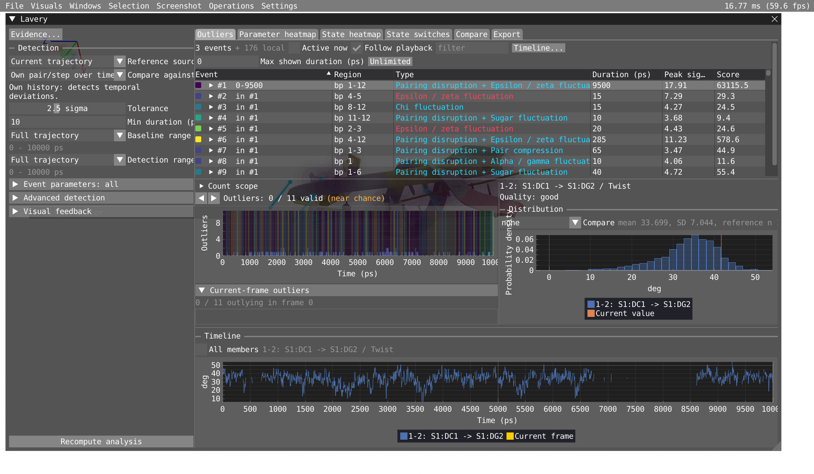
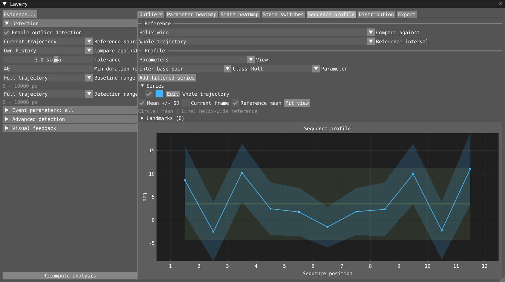
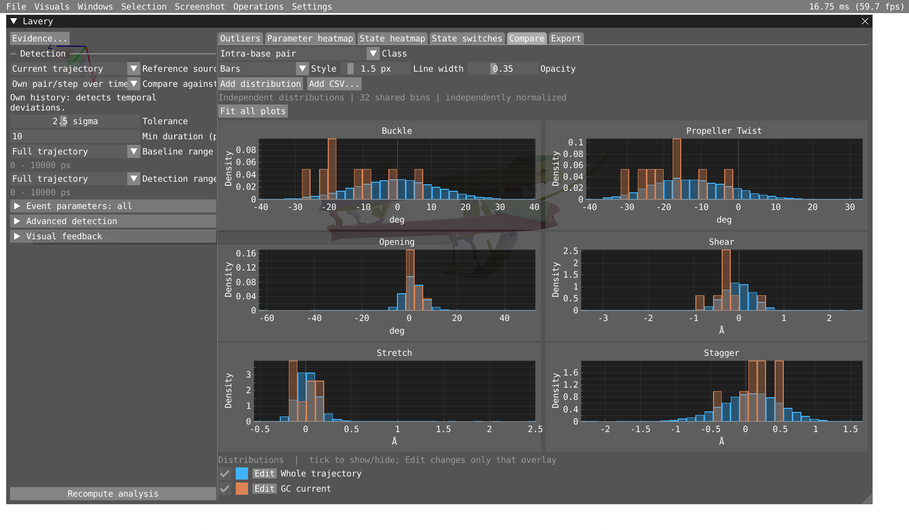
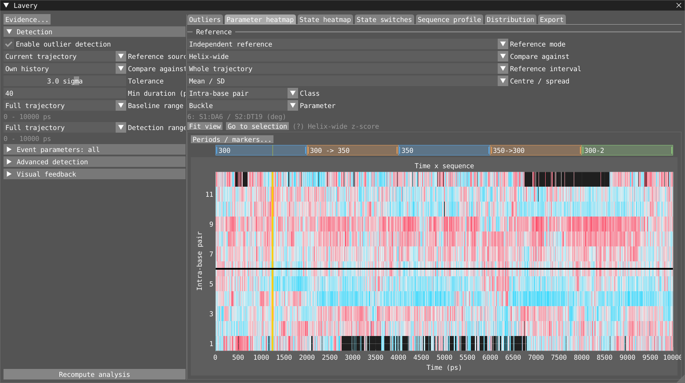
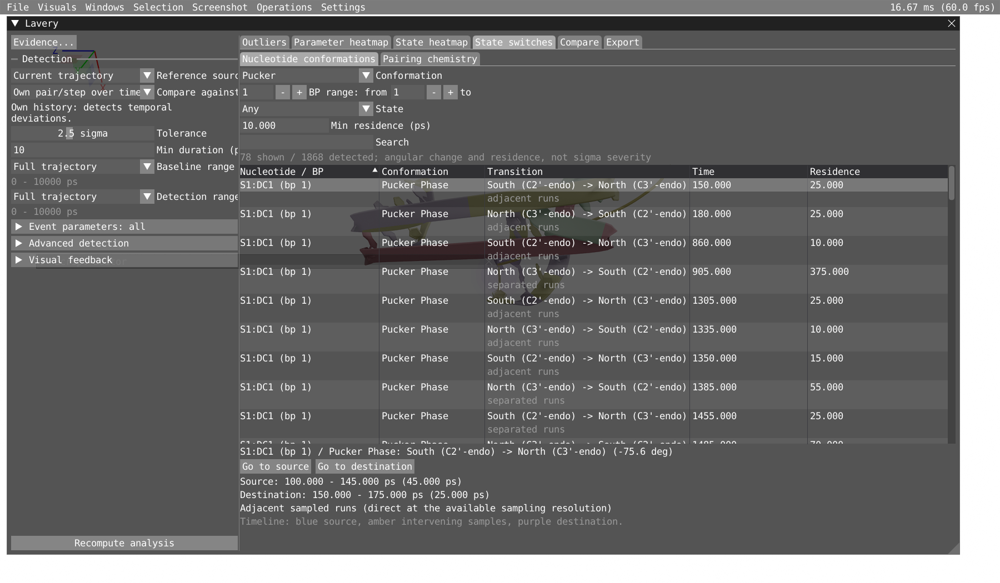
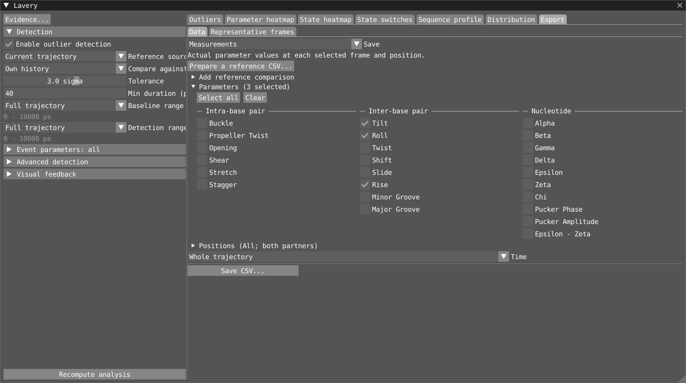
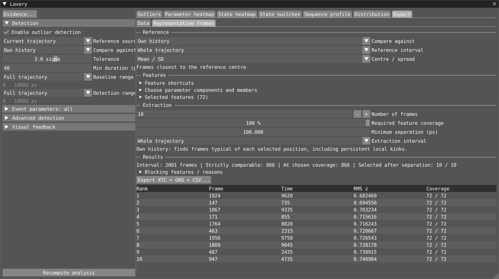

# Lavery: illustrated quick start

Measure nucleic-acid geometry, compare trajectory segments and inspect unusual
frames. Start here; use the [full reference](./lavery.md) for formulas,
CSV columns, scientific validation and [future improvements](./lavery.md#future-improvements).

## 1. Open the example

Open [database/1BNA/1bna.via](../database/1BNA/1bna.via) with
**File > Open Workspace...**. Keep its three inputs in the same folder:
[dna.gro](../database/1BNA/dna.gro),
[box-anneal.xtc](../database/1BNA/box-anneal.xtc) and
[box-anneal.edr](../database/1BNA/box-anneal.edr).
The example has **2001 frames, 0-10000 ps**; Timeline also shows temperature.

Open **Lavery** from the **Windows** menu if needed. Analysis starts
automatically. With your own data, load a nucleic-acid structure and trajectory.

## 2. Choose the view for your question

| I want to… | Open |
|---|---|
| Find unusual geometry over time | **Outliers** |
| See where a parameter deviates across the whole sequence | **Parameter heatmap** |
| Follow BI/BII, anti/syn, pucker or pairing states | **State heatmap** |
| List changes that persist for a minimum residence | **State switches** |
| Compare geometry at each sequence position | **Sequence profile** |
| Compare pooled measurement distributions | **Distribution** |
| Save measurements, summaries or selected frames | **Export** |

Each tab has its own analysis area. Collapse **Detection** in the sidebar when
you do not need it. Hover labels or `(?)` for help.

## 3. Compare the whole trajectory with a subset

In **Sequence profile**, choose **View**, then a parameter or state family.
The default series is **Whole trajectory**.

- **Add filtered series** opens its editor immediately. Choose its name, colour,
  time interval and sequence filters; click **Done**.
- **Edit** reopens the editor; filtered series also offer **Duplicate / Remove**.
- The top series rows use **checkbox / colour / Edit / name** in both
  Sequence profile and Distribution. Uncheck **Whole trajectory** to hide it.
- **Current frame** and **Reference mean** have separate overlay controls.
- **Helix-wide** reference means appear as lines, with an SD band when enabled.
  **Own history** compares each position with its own measurements.
- **Fit view** restores the sequence extent. **Landmarks** groups position
  marking actions; **Shift-click** a profile to mark a position directly.

Profiles preserve sequence positions: filtering leaves gaps, never renumbers.
**Mean +/- SD** shows temporal spread, not uncertainty of the mean.
**Bending / Kinks** is exploratory geometry, not a validated kink assignment.

In **Distribution**, choose the parameter **Class** and add/edit series in the
same way. Each series owns its filters. **Add CSV...** compares an independent
dataset without changing detection. Styling is under **Appearance**.

## 4. Mark time periods directly in a heatmap

Parameter and both State heatmaps have the **same editable annotation lane
as Timeline** above the plot:

| Gesture | Action |
|---|---|
| Shift-drag in the lane or plot | Create a period |
| Shift-click | Create a time marker |
| Drag a bar / its end handles | Move / resize |
| Double-click an annotation | Rename |
| Right-click an annotation | Edit note, colour, following mode or delete |
| Ctrl-drag | Scrub the current frame |

Annotations are shared with Timeline and saved with the workspace.
**Periods / markers...** controls lane layout and shading.
These are **time** annotations; profile landmarks mark **sequence positions**.

Parameter heatmap starts with **Reference**: **Follow detection reference**
keeps its colours aligned with detected events and shows the active settings.
Choose **Independent reference** to explore another reference without changing
detection. State heatmaps show raw states and do not need a reference.

## 5. Inspect outliers and state switches

Under **Detection**, choose the reference, **Tolerance** and **Min duration**.
**Baseline range** defines comparison samples; **Detection range** defines
where to search. **Event parameters** chooses what can form events, independently
of the parameter currently plotted.

Click an event to inspect its peak; expand it for members and parameters.
Playback or a frame change restores automatic feedback. Filter by words or BP
ranges, use **Active now**, or expand **Duration filter** for a maximum span.

For **State switches**, choose the conformation, BP range and destination state;
set **Min residence**, then select a row for source/destination details.
Raw State heatmap colours do not change with residence filtering.

**Keep in mind:** an outlier is not automatically a structural transition.
Unavailable data is not zero or “unpaired”; a pairing-disruption event is not
the same as a chemistry-state assignment.

## 6. Export data—or prepare a reusable baseline

Open **Export > Data** and choose **Save**:

| Save | Contents |
|---|---|
| **Measurements** | Actual values at selected frames and positions |
| **Sequence profiles** | Per-position means/SD or occupancies for each dataset |
| **Distributions** | Histograms and statistics for each dataset |
| **Events & transitions** | Calculated events, nucleotide switches or pairing runs |

Choose measurements and scope, then **Save CSV...**. Profile/distribution
datasets start with Whole trajectory; **Add filtered series / Edit** uses the
same popup interaction as the plotting tabs. Export selections are independent
of plotted series and their visibility.

**To save a baseline for later:** choose **Measurements > Prepare a reference
CSV...**, set **Time** if needed, then **Save reference CSV...**. This presets
all parameters, positions and both partners. **No existing reference is needed.**
Later choose **External reference** in the workflow that should use the file.

Ordinary measurement, profile and distribution exports **do not require a
reference**. **Add reference comparison** is optional; **Twist difference from
reference** is the exception. Detection, Sequence profile, export and frame
ranking have independent references—changing one does not change the others.

## 7. Extract reference-centred frames

Under **Export > Representative frames**:

1. Choose the top **Reference**.
2. Expand **Choose parameter components and members**, select measurements and
   positions, then **Add chosen features**. Bulk actions are in **Feature shortcuts**.
3. Set **Number of frames**, **Minimum separation** and **Extraction interval**.
4. Read the automatically updated **Results** and **Blocking features / reasons**.
5. Inspect a result, then **Export XTC + GRO + CSV...** using a new basename.

**Required feature coverage** defaults to **100%**. If few frames qualify,
inspect the blocking reasons or choose fewer features. Lowering coverage permits
missing features, but frames may then be compared using different subsets; keep
that warning in mind. Counts and omissions are recorded in the output.

These are frames closest to the reference centre—not necessarily the most
populated conformation or the straightest DNA.

**Saving your work:** detection, visual settings and layout are saved with the
workspace, as are shared Timeline periods/markers. Local workflow references,
profile/distribution series and sequence landmarks are session-only; export
results you need to keep.

---

Next: [illustrated GUI tour](./lavery.md#illustrated-gui-tour) ·
[concepts and baselines](./lavery.md#1-concepts) ·
[CSV details](./lavery.md#5-csv-exports) ·
[limitations](./lavery.md#8-limitations) ·
[testing and scientific checks](./lavery.md#9-testing)
