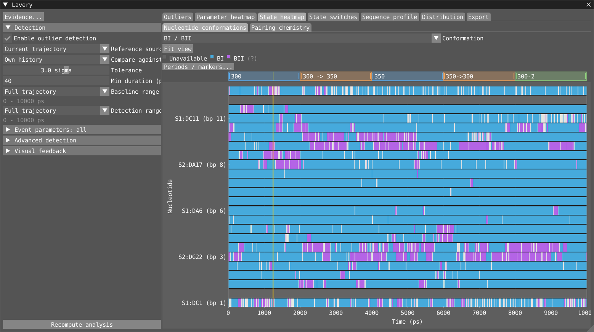
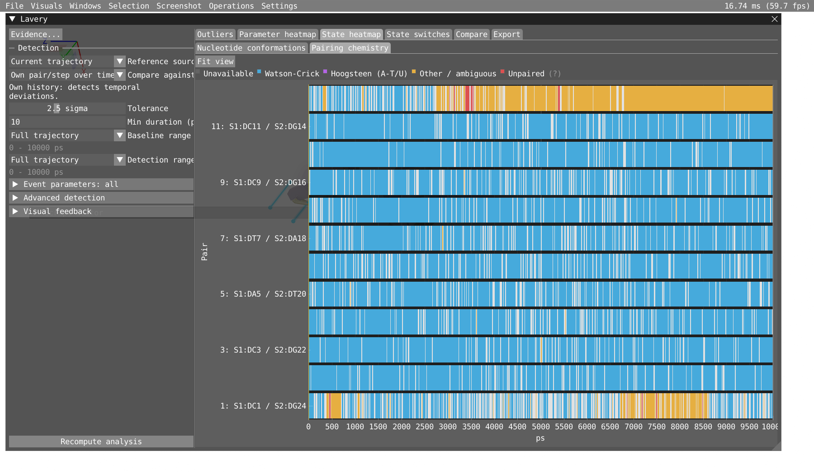
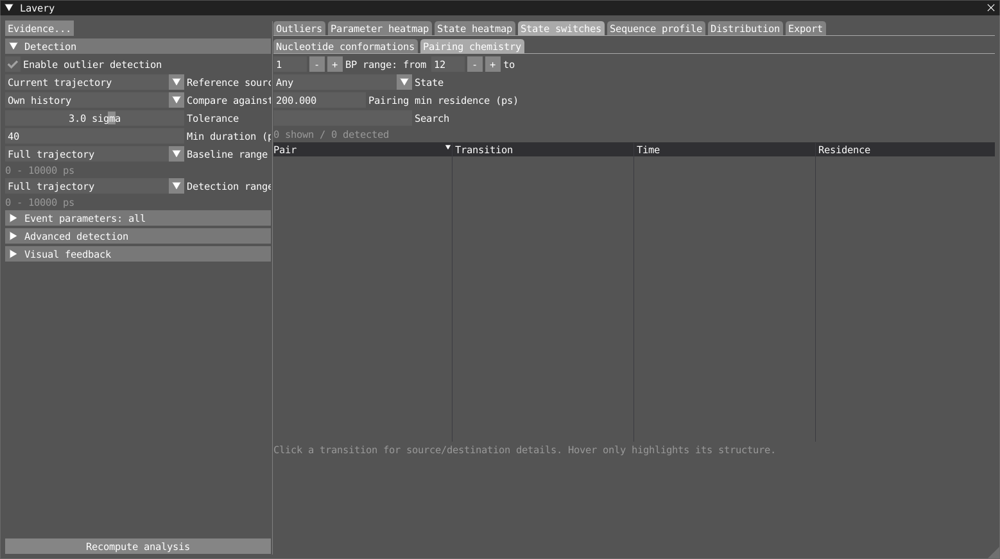

# Lavery parameters: quick start

The Lavery window computes Curves+/3DNA-style base-pair parameters for
nucleic-acid trajectories:

- six **intra-base-pair** parameters: Shear, Stretch, Stagger, Buckle, Propeller, Opening;
- eight **inter-base-pair (step)** parameters: Shift, Slide, Rise, Tilt, Roll,
  Twist, plus Minor and Major groove width (3DNA, minus 5.8 Å);
- ten **nucleotide** parameters: backbone torsions Alpha–Zeta, Chi, sugar
  pucker phase and amplitude, and Epsilon − Zeta (BI/BII).

It then flags frames where a pair, step or nucleotide deviates from its chosen
trajectory or imported control baseline, and detects residence-qualified state switches separately.
For the full reference, see [lavery.md](./lavery.md).

## Download the 1BNA example

The example is included in [database/1BNA](../database/1BNA/):

- [dna.gro](../database/1BNA/dna.gro): DNA structure (758 atoms).
- [box-anneal.xtc](../database/1BNA/box-anneal.xtc): annealing trajectory
  (2001 frames, 0-10000 ps; approximately 5.7 MiB).
- [box-anneal.edr](../database/1BNA/box-anneal.edr): energy data, including
  temperature (approximately 5 MiB).
- [1bna.via](../database/1BNA/1bna.via): ready-to-open VIAMD workspace.

Download all four files into the **same folder**, or clone the repository.
In VIAMD, use **File > Open Workspace...** to open `1bna.via`; its input paths are relative
to the workspace. The workspace loads the energy data and displays temperature
in the Timeline so you can follow the annealing schedule alongside structural
changes. Adjust the Lavery controls as described below.

## GUI tour: 1BNA

These screenshots use the 1BNA DNA trajectory: **2001 frames, 0-10000 ps**.
They illustrate the current interface with a full-trajectory reference, not a
new scientific validation or the restricted baseline used in earlier reports.

### Outliers and Parameter heatmap

The Outliers table, shared middle row and full-width timeline:

The numerical heatmap has independent class/parameter controls:

### State heatmap: nucleotide conformations and pairing chemistry

Raw nucleotide-state history:

Raw pairing-chemistry history:

### State switches: nucleotide conformations and pairing chemistry

Pucker transitions for both nucleotides of BP 1, with selected-transition context:

The separate pairing-chemistry transition table has no qualifying transitions
at the displayed 200 ps residence threshold in this example. This does not mean
the raw pairing history is constant.

### Compare: independent distributions and one shared legend

Six intra-pair parameters compare the whole trajectory with GC pairs at the
current frame. Each overlay has its own source and filters.

### Export: analysis tables and representative frames

Explicit all/shown exports and the Compare histogram export:

Example ranking using all 72 intra-pair features. Broad feature selections can
yield no comparable frames if any required feature is unavailable.

## Watch states change along the trajectory

Open **State heatmap** in the results tabs. Its **Nucleotide conformations**
sub-tab offers BI/BII, anti/syn, sugar pucker and Alpha/Gamma rotamers in the
**Conformation** dropdown; **Pairing chemistry** has its own sub-tab. Each row is a member,
time runs horizontally, and colour is the raw state. Hover for exact values;
click to select the member and jump to that time. White means multiple states
fall in a display bin: zoom in. Grey means unavailable, not physically unpaired.
Minimum residence filters transition tables without repainting this history.

Use **Fit view**, or double-click either the state history or the numerical heatmap to fit the full
trajectory/member extent, even when the display is currently zoomed in.
Raw histories include short excursions; transition tables apply minimum residence
without changing the history colours.

**State switches** has **Nucleotide conformations** and **Pairing chemistry**
views, each centred on its transition table. Pairing lists all pairs by default
(minimum residence 200 ps). Nucleotide controls are ordered **Conformation,
BP range, State**, then minimum residence and **Search**. Pairing chemistry
uses **BP range, State**, then residence and Search.
Search matches member labels, conformation names and transitions.
There is no permanent Selection sidebar or Focus selected pair toggle.
Click event/member/parameter rows or heatmap cells to select what to inspect.
BP bounds are inclusive and 1-based; a nucleotide BP range includes both strands.
**State** selects transitions *into* that state, or **Any**; choose a nucleotide
conformation before selecting a specific state. These controls do not depend on
the member currently selected elsewhere.
Select a row for a detail strip below the table with source/destination spans,
intervening samples, clipping and **Go to source / Go to destination**.
CSV exports remain under **Export > Analysis tables**.
Counts show **shown / detected**. These are
display filters: detection, residence thresholds, Event parameters, raw history
and all-detected export contents do not change. **Export shown nucleotide switches CSV**
uses the nucleotide display filters; the all-switches export does not.
The selected pair is highlighted in the all-member History plot; there is no
duplicate compact timeline. The annotation distinguishes
Watson-Crick, A-T/U Hoogsteen, Other, Unpaired and Unavailable using explicit
directional H bonds and compatible orientations. G-C Hoogsteen is not identified;
hydrogen-free data remains Unavailable for this annotation. The existing
pair-loss detector and numerical validity are unchanged: a Hoogsteen pair can
still have Good quality because one shared canonical bond survives.

## Control references and representative frames

Results tabs are ordered **Outliers > Parameter heatmap > State heatmap > State switches > Compare > Export**.
Each tab fills the analysis area; timeline and distribution are not permanent
panels underneath other tabs. Outliers has the event table on top, the count
overview beside the selected event/member distribution in the middle row,
and the selected parameter timeline spanning the full width below both.
These plots are visible, not hidden in a dialog.
There is no heatmap in Outliers.
Nucleotide and chemistry transitions share State switches; click any column header
to sort, or Shift-click for multiple sort columns. The default order is numeric
BP number, then nucleotide and transition time (pair then time for chemistry).
Raw histories share **State heatmap**. **Parameter heatmap** has local
Class/Parameter controls, a thick black selected-member line and a thick yellow
current-frame line. Parameters and states have separate tabs. Compare has its own tab.
Separate views also contain
Representative frames and Analysis tables under Export.
The shared settings sidebar's **Evidence...** button opens the former Pairing & coverage table
in a resizable dialog. It reports the plotted
class/parameter, not necessarily the state category currently displayed.

### Compare distributions, including an external simulation

Choose **Class: Intra-base pair / Inter-base pair / Nucleotide** to see a grid of
**6 / 8 / 10 parameter distributions**. Initially, the whole trajectory pools all
members. This is a distribution of member-frame samples, not member averages.

**Add distribution** creates an independent overlay. Use **Edit** in the shared
bottom legend to name it, choose its colour and source, and set its filters:

- Whole trajectory, **Current frame (live)**, named period, imported CSV or the
  already loaded detection-reference CSV.
- Inclusive **BP from / BP to**, or **Through last BP**.
- **Pair type:** all, AT/AU, GC or other canonical-base combinations.
  For steps, both endpoint pairs must match the range and type.
- In the nucleotide class, an optional A/T/G/C/U filter.

Adding or editing an overlay never filters the others. **Duplicate** provides a
starting point for a related subset; **Remove** deletes only that overlay.
Legend checkboxes show/hide each overlay across the entire grid.
The current-frame source follows playback and pools selected members in that frame.

**Add CSV...** imports another independent Lavery parameter CSV and adds an overlay.
It does not replace the detection reference. CSV members are pooled without residue
mapping or timestamp alignment. Filters use the CSV's own BP numbering and residue
labels; unavailable filter metadata is reported, not silently ignored. Excluded/
missing CSV samples are unknown because the importer retains valid values only.

Every parameter uses **32 shared bins**, physical units and independent density
normalization. Global **Style: Bars / Lines / Filled area**, **Line width** and
fill **Opacity** apply uniformly. Hover a plot for valid/missing counts, mean
and population SD. Angular series share a circular origin; equivalent angles
may differ by 360 degrees. Overlapping periods share samples; counts are not
independent-observation estimates or significance tests.

**Export > Analysis tables > Export Compare distributions CSV** exports visible
overlays of the selected Compare class, their bin edges/densities, statistics and
source/filter descriptions. This derived CSV is not a raw parameter-reference CSV.
Comparison overlays and style controls are currently session-only.

### Compare against a control simulation

On the control, select **Current trajectory** and the desired **Baseline
range**, then **Export > Analysis tables > Export reference CSV (all classes)**. Open the modified
simulation, choose **Reference source: External CSV**, and import that file.
Check **Reference mapping**; unresolved members require explicit correspondence,
not numerical-index matching. Old plotted-class parameter exports also work,
but cannot provide parameters/classes they did not contain.

Mean/SD or Median/MAD and per-member/pooled comparison still apply. The density
overlay shows the imported reference. Missing reference data is reported, never
replaced with the active trajectory. Save the workspace and keep its reference
CSV available.

### Extract the most baseline-like frames

In **Export > Representative frames**, use **All intra**, **All inter**, **All nucleotide**
or **All classes** for bulk additions. For specific components/members across
classes, expand **Choose parameter components and members**, choose parameters
and members in each column, then **Add chosen features**. You can still add
plotted parameters. Additions combine without duplicates; Clear features resets
the ranking list. Each feature has equal weight, so larger selections give a
class more total influence.
Choose N, minimum temporal separation and whole-run or Detection-range search.
**Rank closest frames** previews actual frames ordered by RMS reference z.
All features need valid values and nonzero reference scale in every candidate.
Click to inspect; **Export XTC + GRO + CSV...** writes a chronological trajectory,
matching first-frame structure and original-frame/time/score/rank mapping.
Choose a new basename: existing outputs are not overwritten.
These are the most reference-centred frames, not necessarily the most populated
structures of the current simulation.

## Five-step workflow

1. Load a nucleic-acid structure or trajectory and open **Lavery** from the
   Windows menu. The analysis starts automatically.
   Settings sit in a sidebar on the left; the events table is on top, with
   the overview (count plot, heatmap) and inspector (timeline, distribution)
   below. Drag the thin dividers between sections, or under any plot or list,
   to resize; double-click a divider to restore its default. Sizes are saved in
   the workspace; **Visual feedback > Reset layout** restores everything. The timeline
   and distribution refit when you select a new series.
2. Choose a class (Intra / Inter / Nucleotide), parameter and member. The time
   series, heatmap and inspector all follow your selection. Bimodal parameters
   (pucker, BI/BII, Chi, Alpha, Gamma) use a separate baseline within each state.
   Sigma measures fluctuations within that state, not the distance between
   states. The inspector and tooltips show the current state.
3. Set the **Tolerance** (outlier sigma). The **Baseline** is under
   **Advanced detection**:
   - **Mean/SD** (default);
   - **Median/MAD**, which stays robust to large excursions.
4. Read the events table. Each one-line row is one local distortion: outliers that
   are close in time and along the helix, so separate kinks are listed
   separately. Rows are sorted by **Score**; each shows its time span, base-pair
   region, a **Type** such as Unwinding, Kink (roll) or Pairing disruption, and duration.
   **Active now** keeps only events spanning the current frame. The **filter**
   box keeps events matching a type or parameter word (`roll`, `unwinding`,
   `loss`) and/or base pairs (`7`, `5-9`); space-separated terms must all match.
   With the table focused, **Up/Down** inspects the previous/next shown event.
   Hover a row for a footprint mini-map (members x frames, amber = pair lost).
   Right-click a column header to show hidden columns (Peak frame is hidden by default).
   - Click a row to jump to its peak and inspect only that event. Resume playback
     or change frame to restore all active events. No pin controls or viewport box.
   - Expand a row to list the pairs, steps and nucleotides involved.
   - Click a member to select it at its peak frame.
   - Click one of its parameter buttons (name and peak z) to select that
     parameter at the frame where it peaks.
   - Right-click a row: **Inspect at peak**, **Select atoms** (VIAMD selection)
     or **Add to timeline** (period on the main timeline). **Timeline...** above
     the table adds or removes all events at once.
   - **Hierarchical events** (on by default) keeps broad parents and adds
     stronger localized children labelled **in #N**. **Burst extra**
     defaults to +1 sigma: at tolerance 2.5, children start at 3.5 sigma.
     Increase it if broad activity still merges the local burst.

   All plots update with each click.
   **Distribution** overlays the inspected event's values across its
   entire frame span on the full-trajectory distribution, for the selected
   member and parameter. This includes valid gap/non-contributing frames.
   All densities use **32-bin bars**, including sparse events; transparent event
   overlays match their contour colour. Legends are below the plots. Median and range summarize
   the event (hover for valid/missing counts); the current-frame line stays visible.
   With trajectory timestamps, **Min duration** and **Bridge gaps** use physical
   time. Toggle **Time in ns** for ps/ns input. Any positive minimum removes
   single-sample spikes; set zero to retain them. The initial minimum is two
   median sampling intervals, not a universal physical lifetime.
   **Baseline range** and **Detection range** both default to **Full trajectory**.
   Choose **Custom** to set inclusive **From / To** time bounds (or frame bounds
   without timestamps). Baseline range defines the reference statistics;
   detection range defines where to search for events and state switches.
   Or choose **Timeline period**, then an existing named VIAMD period. You can
   also drag a period from the timeline onto either range selector. The selected
   name and resolved time/frame span are shown. Renaming/resizing a period keeps
   the link; following periods move with the current frame using VIAMD's usual
   clamping. A deleted period or one covering no samples shows a warning, never
   a silent switch to Full trajectory. Create periods by Shift-dragging in
   VIAMD's timeline; the two ranges may use different periods.
   For example, use an equilibrated 300 K segment as the baseline and search
   during heating without letting heating redefine the reference.
   The count plot, heatmap and distributions still cover the full trajectory,
   but sigma values use the chosen baseline. States absent from that interval
   show **No baseline**, not an outlier or a borrowed reference; state-switch
   detection does not need a baseline. Singleton/constant references have zero
   spread and do not provide a calibrated sigma.
   Boundary-touching events have a `*` after their region: they may extend beyond
   the range. The same duration and gap rules apply to parents and children.
   **Duration** shows elapsed time (hover for contributing frames). Without
   physical time metadata, controls and the column explicitly use frames.
5. Look at the viewport:
   - **Rings** on both bases mark an outlying base pair.
   - A **bar** between two pair centres marks an outlying step.
   - A **sugar-ring outline**, with a short defining-atom path for torsions,
     marks an outlying nucleotide. These cues work with the DNA cartoon;
     no CPK representation is required.
   - **Minor/Major groove:** measurement bands cross the appropriate groove
     between the actual phosphates, not through the helix centre. Minor uses
     two spans, major one; caps identify the backbone endpoints.
   - Crimson means above the baseline, cyan below, grey means previewed but not
     outlying.
   - Hover a marker to see all parameters of that member with values,
     z-scores, outlier flags and conformational states.
   - Click a marker to select that member.
     Clicking a measurement selects its exact parameter.
   - The selected parameter has detailed geometry:
     native VIAMD dihedrals for Alpha–Zeta/Chi, native P–P distances plus the
     corrected groove width, sugar phase/amplitude and state for pucker,
     or a local-frame rotation/translation component for pair/step
     parameters. Epsilon − Zeta shows both defining dihedrals.
     While paused, hovering a parameter button or viewport marker can
     temporarily show its measurement.
   - Detailed geometry respects depth, with faint dashed through-structure
     cues for selected distance/dihedral paths. Context stays subtle and
     **Visual feedback > Measurements > Measurement value labels** enables the text boxes; it is
     **off by default**. Turning text off does not disable geometry, contours or
     hover tooltips.
   - Play the trajectory: all active events automatically get a thin coloured
     silhouette contour around their displayed region, using VIAMD's native
     selection-outline renderer without interior tint. Rings and bars show only current-frame
     contributions (including hysteresis); amber rings mark lost pairs.
     Contour colours match event-table swatches, count-plot bands and newly added
     timeline periods. Events overlapping in time get different colour slots;
     successive events cycle through six Viridis samples (purple to yellow).
     Colours stay stable during playback and table sorting.
   - Shared regions are outlined once, without stacking brightness.
     Local children own their contour inside the parent; otherwise the
     highest-scoring event owns a shared base.
     Hover the cartoon, markers or involved atoms for
     event IDs, types, contributing parameters, values and z-scores.
     No focus mode, pinned event, or permanent viewport status box.
     Contours follow the visible representation and its filters, periodic copies
     and assemblies. Normal selection and hover remain independent, drawn above
     the event contours. **Soft marker halos** affects small markers only.
     **Visual feedback > Event regions > Contour thickness** adjusts the outline from **1x to
     4x** (default **1.5x**). Changes are live, HiDPI-scaled and saved in the
     workspace; **1x** restores the original native width. Normal VIAMD
     selection and measurement line widths are unaffected.
     Dihedral/distance geometry uses the same native script-visualization
     submission and colours as VIAMD's measurement feedback.
     Shift/Ctrl selection gestures keep their native meaning.
   - The GUI is one non-dockable window: settings left, events above the plots.
     Rarely used settings sit in collapsed sections (**Event parameters**,
     **Advanced detection**, **Visual feedback**); help text is in
     tooltips (hover labels or `(?)`). There is no Tools section;
     **Recompute analysis** is at the bottom of the sidebar.

### Visual feedback dropdown

Expand the sidebar's **Visual feedback** header to show its controls;
collapse it again to keep the sidebar compact.

- **Event regions:** select **Contour**, **Glow**, **Both**, or **Off**.
  Contour is the default. Adjust contour thickness (1-4x) and/or glow strength
  (0-1, default 0.5); the same Viridis colours and child-priority rules apply.
  Off hides region context only, leaving precise contribution markers and
  measurements available. **Signed outlier overlay** is the master switch.
  **Soft marker halos** is independent of the region style.
- **Measurements:** adjust **Line thickness** (1-6 screen pixels),
  **Line opacity**, **Plane opacity**, and point/line/plane colours.
  These settings are shared with ordinary VIAMD script measurements, also
  accessible from the script editor's **Settings > Measurement visuals**.
  They do not change native selection/hover. Try 2-3 px lines and line opacity
  0.8 first; increase plane opacity only if the angle planes remain hard to read.
  Native defaults remain 1 px, line opacity 0.6 and plane opacity 0.5.
- **Reset visual defaults** restores the event style and shared measurement
  defaults, without changing detection or selections. Axis and Reset layout
  remain accessible in the expandable section; heatmaps have their own analysis tabs.
  Changes are live and workspace-saved.
- Glow is colour-only: it cannot block cartoon/atom picking or overwrite motion
  data. Contours follow the actual representation; the optional broad glow uses
  the original base-centred context geometry.

## Starting settings for the supplied NVT trajectory

The 1 ns `box-nvt.xtc` sensitivity check shows that **2.5 sigma with all
parameters can merge activity into one whole-run parent**. This is not evidence
of a continuous structural transition.

- For a more selective first pass, try **Mean/SD**, **3.5 sigma**, **10 ps**
  minimum duration for brief-excursion screening, no gap bridging, and
  **Stronger** sub-events. Inspect
  intra/inter parameters separately from nucleotide parameters using the
  **Event parameters** class headers; changing the plotted class alone does not
  change detection.
- For **State switches**, the sensitivity audit compares **25 ps and 50 ps**
  minimum residence. On this
  trajectory, the count falls from 172 at 10 ps to 57 at 25 ps and 21 at 50 ps.
  Residence is required on both sides of a transition.
- Review Chi at `12b` around 155-335 ps and sugar phase at `3a` around
  625-760 ps as inspection candidates, not confirmed anti/syn or pucker changes.
  Many longer-lived Chi candidates involve the terminal pairs.

These are exploratory settings for this dataset, **not new defaults or calibrated
false-positive rates**. Full results and limitations are in the reference's
Testing section.

For a less flickery exploratory starting point, use **25 ps minimum event
duration** and **50 ps minimum state residence**, then compare events at 50 ps
and residence at 100 ps. The saved frames here are 5-10 ps apart: a 10 ps span
can contain only two or three samples. These thresholds filter sampled
fluctuations; they are not universal DNA timescales. State residence, transition
time and waiting time are different quantities, and a grouped event's duration
does not mean that a base pair stayed continuously open. For annealing, compare
temperature phases with the same thresholds. Production defaults are unchanged.

**Independent Curves+ check:** all 191 frames now agree for the 12 pair/step
parameters (maximum differences below 0.051 degrees and 0.006 Angstrom) and
the seven nucleotide torsions (below 0.051 degrees). Earlier large discrepancies
were caused by exporting periodically split molecules, not the VIAMD calculations.
Sugar phase/amplitude use Altona-Sundaralingam in VIAMD, while Curves+ uses a
Fourier fit; these differ by about one degree RMS here. Matching the Fourier
convention reproduces Curves+ within 0.051 degrees. Groove widths use different
definitions and are not a numerical identity check.

## Nucleotide quality

- **Missing/nonfinite/degenerate geometry:** only affected parameters are
  unavailable and excluded from analysis. Missing terminal torsions are normal.
- **Distorted but calculable geometry:** warnings only; finite values stay in
  statistics and event detection so real deformation is not hidden.
- **Settings > Evidence...** shows quality for the selected parameter. Hover a
  viewport marker to see parameter-specific reasons; parameter CSV exports
  preserve the same flags and reasons.
- The inspector and hover details distinguish **Unavailable - excluded from
  analysis** from **Warning - finite value retained**. Quality flags on a
  finite pair/step value are shown as retained context, not as a missing value.
- Warnings cover unusually short/long defining bonds (including sugar-ring
  closure) and poor pucker fits. They are conservative heuristics, not automatic
  evidence of bad dynamics. This NVT trajectory produced no distortion warnings.

## Interpreting NVT state-switch candidates

At 50 ps residence, all eight Epsilon - Zeta candidates, but only two of eight
Chi candidates and none of five phase candidates, remain matched under every
tested +/-5 and +/-10 degree state-boundary shift. These are robustness checks,
not proof of physical transitions. Start inspection with Epsilon - Zeta `9b`
at 115-275 ps and `4a` at 420-585 ps.

Importantly, 13/21 candidates compare qualifying states separated by shorter
excursions: the listed start need not be an instantaneous switch. Some source
runs are hundreds of ps earlier. A broad anti/syn label also does not establish
a complete base flip. See the reference's candidate audit and prepared annealing
protocol for matching criteria, boundary sensitivity and recovery comparisons.

Hover a state-switch row or click it to inspect the **source**, intervening
samples and **destination** separately. The timeline shades source blue,
intervening samples amber and destination purple. Rows distinguish adjacent
sampled runs from separated qualified runs; the listed start is destination
onset, not a measured instantaneous transition.

**Ongoing at trajectory end** and **range-clipped** runs have only an observed
residence: their complete lifetime is unknown. The inspector also marks sources
already present at the start boundary. Its selection summary stays inside the
GUI, includes current-sample quality, and also summarizes selected outlier events.
State-switch CSV exports include source timing, intervening sample counts and
boundary flags. Detection thresholds and qualification rules are unchanged.

## Useful controls

| Control | Effect |
|---|---|
| Event parameters | Any of the 24 parameters via the Intra / Inter / Nucl. grid (default all); column headers toggle a whole class; independent of the plotted class |
| Neighbourhood (bp) | Outliers join one event only if at most this many base pairs apart (default 2) |
| Whole structure | Ignore position: one event per stretch of outlying frames |
| Hierarchical events | Keep broad parents plus higher-threshold localized children (default on); off restores flat grouping |
| Sub-events | **Stronger** (default): children exceed a higher threshold. **Stand out from background**: children differ from the parent's per-frame median z, so local activity inside an equally strong broad event is found |
| Burst extra | Stronger mode: child start = tolerance + this (default +1 sigma); children retain the same hysteresis and duration/gap filters |
| Residual | Background mode: child start = \|z − parent background\| (default 2 sigma); needs at least 5 valid members in the parent region |
| Hysteresis | Events start at the tolerance and continue down to tolerance minus this (default 0.5 sigma) |
| Pairing disruption | Original pairing geometry/canonical contacts fail; counts as outlying (default on), not necessarily chemistry Unpaired |
| Min duration | Minimum elapsed first-to-last contribution time, including bridged gaps; zero retains spikes |
| Bridge gaps | Maximum quiet-gap time; adjacent samples always connect (subject to spatial grouping) |
| Time in ns | Switch duration, gap and range inputs between ps and ns without changing their physical values |
| Baseline range | Full trajectory (default), Custom or Timeline period for reference center/scale and state occupancy |
| Detection range | Full trajectory (default), Custom or Timeline period for the search, independent of the baseline |
| Min frames / Bridge gaps (frame fallback) | Without timestamps: contributing-frame minimum (default 3), and maximum quiet frames |
| Timeline... (events toolbar) | Add or remove every event as a period on the main timeline |
| Active now | Show only events spanning the current frame |
| Filter (events toolbar) | Type/parameter words and base-pair numbers or ranges; all terms must match |
| Up / Down (events table focused) | Inspect the previous / next shown event |
| Export events CSV | One row per event, member and parameter |
| Export CSV | Per-frame parameter values, z-scores and flags, with baseline method and interval |

The outlier-count plot shades events and draws a dashed line at the number of
outliers expected by chance. If the curve stays near that line, most hits are
noise.

The hierarchy has two levels. Children must touch fewer base pairs than their
parent. In **Stronger** mode equal-strength local activity is not separated;
switch **Sub-events** to **Stand out from background** for that (e.g. a local
opening during whole-DNA unwinding). Parent/child scores overlap: do not add
them as independent events. CSV includes `parent_event`, `burst_sigma` and
`burst_mode`.

Six colour-blind-friendly colours go to the highest-scoring events first;
further overlapping events are grey and the overview shows **+N grey**. Settings
changed while a slider is held are applied on release ("updating on release").

Angular parameters such as Twist and Opening wrap correctly at +/-180°.

## State switches, separately from outlier events

Use **State switches > Nucleotide conformations** beside **Outliers** for North/South, BI/BII,
anti/syn and Alpha/Gamma rotamer changes. Both the source and destination
must meet **Min residence** (ps/ns, or frames without physical timestamps).
The initial residence is the event minimum duration; it can be adjusted
independently. Short visits are ignored; missing samples reset the source.
The first state in a detection range is not itself a transition.

Rows show the state transition, destination residence and shortest signed
angular change between the source/destination run circular means, **not a
sigma severity score**. Click to isolate the nucleotide, update all plots,
and overlay the destination-run distribution. Play/change frame restores
automatic event feedback. **Export > Analysis tables > Export state switches CSV**
saves the transitions separately from sigma outlier events.

The **Event parameters** mask and **Detection range** apply to outliers and nucleotide switches;
sigma, hierarchy and gap bridging apply only to outlier events.
Pairing chemistry switches use the selected pair over the whole run and their
own residence setting, independent of that mask/range.

## What's left to do

### Completed

- [x] Compare an inspected event's full-span distribution with the trajectory,
  with shared bins, independently normalized density, short-event sample marks
  and missing-value reporting.
- [x] Physical-time minimum and gap bridging, ps/ns controls, optional detection
  interval, boundary-clipping warnings and CSV provenance.
- [x] Lighter GUI: one-line event rows, row actions in a right-click menu,
  collapsed advanced settings, help in tooltips, resizable and saved section
  and plot sizes, **Active now** filter, text/base-pair filter, Up/Down event
  navigation and a hover footprint mini-map.
- [x] Background sub-events: children detected against the parent's per-frame
  median z (residual), finding local activity no stronger than the broad event.
- [x] Long-trajectory performance: synthetic 100k-frame benchmark test (about
  0.1–0.2 s per detection, Release build), cached event type/filter text, and
  recomputation deferred until a slider is released.
- [x] Event colours: six Viridis samples cycle chronologically, with overlap
  avoidance, score-prioritized allocation and grey overflow with a **+N grey** note.
- [x] More parameters: Nucleotide class (backbone torsions, Chi, sugar pucker,
  BI/BII), minor/major groove widths in the step class, within-state baselines
  and separate residence-qualified conformational switches.
- [x] Local smoke check on the supplied DNA trajectory: all 191 frames
  (0–1 ns), all 24 parameters, distributions, both hierarchy modes and a
  restricted detection interval. See the reference's Testing section for
  results. This is not an independent 3DNA/Curves+ comparison.
- [x] Repeatable NVT sensitivity sweep: both baselines, separate parameter
  scopes, two sigma thresholds, two event durations, both hierarchy modes and
  four state-residence thresholds; all-metric histogram and event-span checks.
- [x] Independent local Curves+ comparison of all 191 NVT frames, after
  whole-duplex export and a periodic/non-periodic invariance check; matching
  pair/step and torsion values, and an explicitly separate Fourier pucker check.
- [x] Cartoon-first feedback: groove-specific phosphate bands, sugar outlines,
  native distance/dihedral geometry, local-frame component diagrams and
  optional selected-measurement value labels (off by default). Native
  representation contours are the default, with optional Glow, Both or Off,
  child-priority colour and click-to-isolate inspection.

### Validation still needed

- [ ] GUI check of playback and scrubbing: every active event should show its
  coloured extent and current contributors, including overlapping parents and
  localized children. Check hover details and pair-loss markers.
- [ ] GUI check of paused inspection: clicking an event, member or parameter
  should hide other events; Play or a frame change should restore automatic
  feedback without leaving stale highlights.
- [ ] GUI check of the shared row/sidebar dividers (drag, double-click
  reset, Reset layout, workspace save/load), smaller window sizes, the row
  context menu, hidden columns, Active now, the filter box, Up/Down navigation
  (should not move ImGui's navigation highlight) and the footprint tooltip.
- [ ] GUI check of plot refitting, cursor follow when zoomed (playback and
  event clicks), timeline actions and CSV export.
- [ ] GUI check of ps/ns conversion, range edits, clipped-event labels and
  duration sorting; old workspace thresholds should migrate using sampling time.
- [ ] GUI check of **Sub-events** (Stronger / Stand out from background), the
  Residual slider, "updating on release" while dragging, grey overflow and the
  **+N grey** note; confirm the palette reads well on the viewport contours.
- [ ] Validate background sub-events on real data (e.g. a local opening during
  global unwinding at high temperature); small parent regions give noisy medians.
- [ ] GUI check of the Nucleotide class: class switch, Nucl. column in Event
  parameters, sugar outlines, state text in tooltips, heatmap rows
  `3a`/`3b`, and old workspaces gaining the new event parameters.
- [ ] GUI check on the DNA cartoon of both groove bands and their flanking
  backbone highlights, native torsion paths/arcs, pucker labels and pair/step
  component diagrams. Check exact-parameter picking, paused hover previews,
  depth/hidden cues, label overlap, lazy-render persistence and playback.
- [ ] GUI check of State switches, independent residence controls, isolated
  inspection, destination-run distributions and CSV export; confirm labels
  default off and parent/sub-event contours remain independently readable.
- [ ] Broaden independent checks beyond this DNA trajectory. Curves+ pair/step,
  torsions and matched-convention pucker pass; direct P-P and curvilinear groove
  widths still need a definition-aware comparison. 3DNA is not being installed.
- [ ] Validate event thresholds and hierarchy on representative trajectories,
  not just synthetic cases. Confirm that detected bursts reflect meaningful
  structural changes rather than noise or pairing-quality failures.

### Future improvements (not implemented)

- [ ] More than two hierarchy levels (recursive sub-events) and a background
  that is a local sliding median along the helix instead of the parent region.
- [ ] Profile the per-frame preparation of samples in the GUI (z-scores for
  every member) on very large systems; detection itself is fast.
- [ ] Per-class event defaults: events now use all 24 parameters, which raises
  the chance level; consider defaulting to intra + inter only.
- [ ] Analysis of unpaired nucleotides (overhangs, loops); nucleotide quality
  flags for currently analysed paired nucleotides are implemented.
- [ ] Compare groove widths with Curves+ (curvilinear) grooves.

Automated validation currently covers 105 regular Lavery tests and one optional
local-trajectory check. This does not replace
the GUI and scientific checks above.
