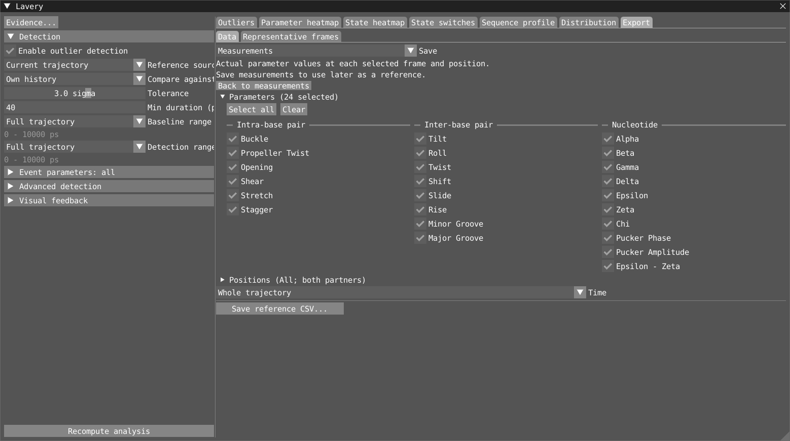

# Lavery parameters: reference

This page describes the Lavery component in
`src/components/lavery/`. For the short version, see
[quick start](./lavery-quickstart.md). This reference contains the detailed
workflows, scientific interpretation and validation record.

## Find what you need

- [Concepts and baselines](#1-concepts)
- [Window layout and controls](#2-window-layout)
- [Illustrated GUI tour](#illustrated-gui-tour)
- [Outlier events](#3-outlier-events)
- [Viewport feedback](#4-viewport-feedback)
- [CSV exports and representative frames](#5-csv-exports)
- [Workspace keys](#6-workspace-keys-lavery-section)
- [Implementation notes](#7-implementation-notes)
- [Limitations](#8-limitations)
- [Testing and scientific checks](#9-testing)
- [Historical scientific validation](./lavery-validation.md)
- [Future improvements](#future-improvements)

## 1. Concepts

| Class | Members | Parameters (unit) |
|---|---|---|
| Intra-base pair | each detected base pair | Shear, Stretch, Stagger (Å); Buckle, Propeller, Opening (°) |
| Inter-base pair (step) | each pair of consecutive base pairs | Shift, Slide, Rise (Å); Tilt, Roll, Twist (°); Minor and Major groove width (Å) |
| Nucleotide | each paired nucleotide (two per base pair) | Alpha, Beta, Gamma, Delta, Epsilon, Zeta, Chi, Pucker phase, Epsilon − Zeta (°); Pucker amplitude (°, linear) |

Each frame produces one value per member and parameter, or no value when the
geometry is invalid. Quality flags explain why a value is missing or suspicious.

### Workflow boundaries

| Workflow | Reference | Selection and output |
|---|---|---|
| Outliers | Detection reference; state-conditioned Mean/SD or Median/MAD | Event parameters control detection, not the plotted parameter |
| Parameter heatmap | Follows detection by default; optional Independent reference | Changing an independent reference changes colours, not events |
| State heatmap / State switches | None; raw categories / residence-qualified changes | Residence filters do not alter raw state colours |
| Sequence profile | Local reference; raw mean/population SD | Series visibility and filters affect plots, not export datasets |
| Distribution | Independently filtered current/CSV datasets | A comparison CSV does not replace the detection reference |
| Data export | Optional local reference | Explicit export measurements, positions, intervals and datasets |
| Representative frames | Required local reference | Ranks distance from its centre, not population or straightness |

Detection settings/references, layout and visual settings are workspace-persisted.
Local workflow references, comparison series, export choices and sequence
landmarks are session-only. Loading a workspace restores their defaults rather
than carrying settings or cached results from the previous workspace.
Time periods/markers belong to VIAMD's shared Timeline and are saved there;
sequence landmarks mark positions, not times.

### Baselines and z-scores

**Reference source** chooses **Current trajectory** (default) or **External CSV**.
With External CSV, **Import reference CSV...** loads a Lavery **parameter** CSV
from another simulation, for example an unintercalated control. Its valid raw
`value` samples define the baseline; stored means, SDs and z-scores are ignored.
Frame counts and timestamps need not match the active trajectory. Mean/SD,
Median/MAD, circular wrapping and within-state baselines retain their usual
definitions. The current trajectory is never mixed into an external reference.

Use **Export > Data > Measurements > Prepare a reference CSV...** on the control.
This presets all parameters, positions and both partners. Choose **Time** (whole
trajectory, a named equilibration period or a custom interval), then **Save reference CSV...**.
No existing reference is needed. The comparison method fits the baseline when
these raw samples are imported. Narrowing parameters/positions is allowed, with
a warning that only exported measurements will be available later.
Ordinary measurement exports save the explicitly
chosen parameters and positions; those files (including older exports without
`reference_source`) can also be imported, but absent classes/parameters have no
reference. Event CSVs, snapshot-oracle CSVs and arbitrary wide tables are not
parameter-reference files. Import currently accepts one run per file and
rejects malformed records, duplicate samples, invalid valid-flags, nonfinite
values marked valid, unknown parameters/classes and incompatible units.
Distances must be `Angstrom`, angles `deg`.

**Reference mapping** previews correspondences and sample/parameter counts.
Automatic matching uses strand/residue identities and **ordered** pair
partners, not the numerical member index. Nucleotides also retain their parent
pair identity; steps retain both ordered pairs. Pair reversal is not silently
normalized because it can reverse signed components. If strand assignment,
residue numbering or topology differs, choose correspondences explicitly;
ambiguous/unmatched identities are never guessed. Each reference member maps
to at most one current member within its class. Manual correspondence is not
a sequence alignment or a sign/convention conversion: verify compatible
biological partners, pair orientation and measurement definitions.

In External CSV mode, **Own history** means the corresponding
mapped member's imported history. **Helix-wide** pools imported
members mapped to the current helix, weighted by finite samples and counting
each source once. An unmatched target never borrows a neighbor's reference.
No current baseline range is applied: the full imported sample population is
used, and the current-trajectory Baseline range control is disabled. Export a
restricted control reference first if a smaller reference interval is needed.
The inspector overlays a yellow external-reference density (current state for
state-conditioned parameters) alongside the current simulation's distribution.

Missing mappings, parameters, reference states or a failed/missing file mean
**No reference**, not a fallback to the active simulation. A zero reference
scale is not calibrated evidence of an outlier. Pair-loss gating still
requires that the mapped individual pair has a finite Buckle reference;
pooled neighbors cannot establish its pairing history. Pairing-state and
nucleotide state-switch classifications remain independent of the baseline.

The external path and explicit member mapping are saved in the workspace.
A record-content fingerprint detects a changed CSV on reload; the reference
is unavailable until **Reload reference (accept changed file)** is chosen.
This fingerprint is an integrity/change indicator, not a cryptographic hash.
Parameter/event exports append `reference_source`, containing the source path,
fingerprint and mapped source labels (or `current_trajectory`). External
baseline start/end fields are NaN: current timestamps do not describe the
independent simulation. Keep the CSV alongside the workspace for portability.

**Compare against**, above Tolerance, selects the detection reference:

| Reference | Meaning |
|---|---|
| **Own history** (default) | Each location is compared with its own history; detects temporal deviations. Nucleotide parameters use that nucleotide's history. |
| **Helix-wide** | Pool the same parameter across all locations in one helix over the baseline time range, including the selected location. Nucleotide parameters pool nucleotides. Detects persistent local differences as well as excursions. |

For example, a step with Rise consistently at 7 Angstrom can stand out against
the other steps near 5 Angstrom even though it never changes over time.
Significance still depends on the pooled spread and number of members; there
is no guarantee that every elevated value exceeds the chosen tolerance.
Helices are never mixed; isolated pairs form their own reference groups.
Only finite samples contribute, weighted equally per sample, not per location.
The baseline interval applies to both modes. This is not a same-frame comparison.

The count plot, viewport, outlier list and detected spans use the detection
reference. Parameter heatmap follows it by default, but can explicitly use an
independent reference. Labels distinguish Own history from Helix-wide z-scores.
The **Outliers** tab also shows persistent anomalous regions: a region lasting
the whole trajectory is not evidence that a transition occurred during recording.
Sequence differences, end effects and short helices require interpretation.
State-switch detection remains independent of this choice.

For either reference:

```
z = (value - center) / scale
outlier  <=>  |z| > Tolerance
```

| Baseline | center | scale |
|---|---|---|
| Mean/SD (default) | finite-sample mean | population standard deviation |
| Median/MAD | median | 1.4826 x median absolute deviation; falls back to SD when MAD = 0 |

The Mean/SD baseline is pulled towards long excursions, so the excursion
partly hides itself. Median/MAD is robust to these, so use it when a
distortion lasts a sizeable fraction of the trajectory.

Constant series have a zero z-score. Non-finite values are excluded.

**Angular parameters.** Buckle, Propeller, Opening, Tilt, Roll and Twist are
treated as circular quantities:

- Before computing the baseline, the series is unwrapped around its circular
  mean, so values such as 179° and -179° count as 2° apart.
- Deviations are then wrapped into [-180°, 180°).
- Unwrapping only changes values that are at least 180° from the reference.
  Ordinary data is therefore processed exactly as before.

Changing the reference scope, baseline method or reference interval recomputes statistics on
edit release; the geometric parameters are not recalculated.
In pooled mode the Distribution plot overlays **Helix-wide reference**, using
the selected helix and baseline interval (and current state for state-conditioned
parameters), alongside the selected member's full-trajectory density and current
value. Reference sample counts refer to the pool, not the selected member.
Circular reference fitting and within-state baselines apply in both modes.
`ReferenceScope` is saved in the workspace; older workspaces default to own history.

### Baseline range versus detection range

Both controls default to **Full trajectory**. Choose **Custom** for inclusive
**From / To** time bounds (ps/ns), or inclusive frame bounds without timestamps.
Alternatively choose **Timeline period** and select an existing named VIAMD
period. Dragging a timeline period onto either range selector selects it directly.
The period chooser highlights hovered entries in VIAMD's timeline.

- **Baseline range** defines the reference center/scale, circular unwrapping
  reference and within-state statistics/occupancy.
- **Detection range** defines where outlier events and residence-qualified state
  switches are searched for. It does not change the reference statistics.

The intervals may be disjoint. For example, select an equilibrated 300 K plateau
as the reference and detect deviations during heating. Heatmaps and count plots
still cover the full trajectory, using that reference; raw timelines and density
distributions remain full-trajectory as well.

Period links use VIAMD's persistent period IDs, not names or list positions, so
renaming or reordering does not break them. Resizing updates analysis on edit
release. Resolution reuses `timeline_period_frames`: endpoints are normalized
and clamped to the trajectory; following periods track the rounded current frame.
The UI shows the name, resolved time/frame bounds and whether the period follows.
Markers are allowed as one-sample intervals (subject to the ordinary zero-spread
baseline and minimum-duration rules). Following baselines recompute as their
resolved frames change, so long trajectories may be slower during playback;
fixed equilibrium periods are preferable for a stable scientific reference.

Deleted/unselected periods and periods covering no trajectory samples are
reported explicitly, with no fallback to Full trajectory. A missing baseline
period removes sigma references but not baseline-independent state switches.
A missing detection period clears both event and state-switch searches.
Old workspaces retain Full/Custom behavior; period modes and IDs are saved
alongside VIAMD's own periods.

Only finite reference samples contribute. A member/state with no reference
samples is labelled **No baseline**: its z-score is `nan`, it is excluded from
sigma-tested coverage and it cannot become a sigma outlier. No other state's
statistics are substituted. State-switch detection still works without that
reference because it uses state assignments and residence, not sigma.
Singleton/constant reference samples retain the existing zero-spread behavior
(zero z-score, no sigma outlier), not a statistically calibrated reference.

Time intervals may intersect the trajectory without matching sample timestamps
exactly; only saved samples inside them are used. Empty, reversed or non-finite
baseline intervals report an error and remove sigma references instead of
silently using the full trajectory. Both ranges are saved in the workspace;
older workspaces retain their detection range and use a full-trajectory baseline.

### Nucleotide class (sugar and backbone)

Nucleotide members are numbered 2·pair + side; the inspector and tooltips label
them as `S1:DA5 (bp 3)`. Only nucleotides that belong to a detected base pair
are analysed. Values are computed for every frame, even when the pair is
broken. Nucleotide quality is tracked separately for each parameter, not
inherited from the parent pair.

| Parameter | Atoms (IUPAC) |
|---|---|
| Alpha | O3′(i−1)–P–O5′–C5′ |
| Beta | P–O5′–C5′–C4′ |
| Gamma | O5′–C5′–C4′–C3′ |
| Delta | C5′–C4′–C3′–O3′ |
| Epsilon | C4′–C3′–O3′–P(i+1) |
| Zeta | C3′–O3′–P(i+1)–O5′(i+1) |
| Chi | O4′–C1′–N9–C4 (purines), O4′–C1′–N1–C2 (pyrimidines) |
| Pucker phase P, amplitude τm | Altona–Sundaralingam pseudorotation from ν0..ν4 |
| Epsilon − Zeta | BI (< 0°) / BII (> 0°) indicator |

The neighbouring O3′(i−1), P(i+1) and O5′(i+1) are used only when an O3′–P
bond exists, so Alpha is missing at a 5′ end and Epsilon/Zeta at a 3′ end.
Torsions use minimum-image bond vectors. Amplitude is linear; all other
nucleotide parameters are angular.

**Nucleotide quality policy.** Missing defining atoms, nonfinite coordinates
and degenerate torsions make only the affected parameters unavailable (NaN).
They are excluded from baselines, distributions, sigma events and state-switch
runs by the existing missing-data rules. A flat sugar with amplitude below
0.0001 degree has undefined phase but retains its finite, near-zero amplitude.
For Epsilon - Zeta, quality is the union of the Epsilon and Zeta flags.
Sugar-ring failures affect phase/amplitude, not unrelated backbone torsions;
a shared atom can of course affect more than one parameter.

Distortion is **warning-only**, not an exclusion criterion:

- A defining heavy-atom bond outside 1.0-2.1 Angstrom flags the torsions using
  it. Phase/amplitude check all five sugar-ring edges, including ring closure.
- A five-torsion Fourier-fit RMS residual above 5 degrees flags phase and
  amplitude. This diagnoses poor first-harmonic ring agreement; it does not
  change the production Altona-Sundaralingam values or state definitions.

These broad warning thresholds are heuristic, not a calibrated force-field
validation. Finite warning-bearing measurements remain in all analysis and
event detection: unusual deformation may be the signal of interest.
The selected parameter's quality appears in **Settings > Evidence...** and plot
tooltips. Viewport tooltips name each affected parameter and its reasons.
Parameter CSV rows carry the individual parameter's flags and explanations;
warnings do not change the `valid` column to zero.
Scripts receive a U16 frame-by-nucleotide attribute alongside each parameter,
e.g. `lavery/nt/alpha_quality` alongside `lavery/nt/alpha`.
Flag bits are 512 (missing atoms), 128 (nonfinite coordinates), 4096
(degenerate nucleotide geometry), 8192 (unusual bond) and 16384 (poor pucker fit).
The latter two are warnings; zero means no issue detected.
New thresholds/flags do not change pair/step quality handling.

**Grooves.** Minor and Major groove widths belong to the step class and use
the 3DNA phosphorus-distance definition (El Hassan & Calladine), for 1-based
step *i* along one helix:

```
minor(i) = ½(|P1(i+2) − P2(i−2)| + |P1(i+3) − P2(i−1)|) − 5.8 Å
major(i) = |P1(i−1) − P2(i+2)| − 5.8 Å
```

P1/P2 are the phosphorus atoms on the two strands. The 5.8 Å phosphate
diameter is subtracted (3DNA reports the raw P–P distance). Steps too close to
a helix end, or with a missing P, have no value. Grooves are computed from the
phosphates even when the step itself is flagged by quality checks.

**Within-state baselines.** Phase (North [270°, 90°) / South [90°, 270°)),
Epsilon − Zeta (BI / BII), Chi (anti / syn: syn between 270° and 90°), Alpha
and Gamma (g+ [0°,120°) / t / g−) have discrete states. Each reference population
(Own history or Helix-wide) has a separate center/scale for each state;
a sample's z-score uses its current state's
reference. A switch does not acquire an enormous z merely because the dominant
state is tightly clustered. Singleton/constant states have zero z, not a
borrowed reference from another state. Tooltips and the inspector show the
current state and the dominant state's fraction of baseline samples. The heatmap
uses the same baselines. The inspector reference and parameter CSV center/scale
also use the current state; the total reference count includes every state
represented inside the baseline range. Occupancy is a sample fraction, not
elapsed-time weighting for irregular sampling. In pooled mode these fractions
describe the helix reference, not the selected nucleotide's own occupancy.

### Residence-qualified state switches

The **State switches** tab detects changes independently of sigma outlier
events. A source run and a destination run must each meet **Min residence**:
elapsed first-to-last sample time with physical timestamps, or contributing
samples in frame fallback. Any positive time minimum rejects singleton runs.
Short excursions are ignored. Missing data resets the remembered source.
Detection starts fresh at the selected range boundary; no transition is inferred
from an unseen source outside it. No gaps are bridged and no hierarchy is applied.

The default residence is **200 ps**, independently adjustable from the outlier
duration (also initially 200 ps) and pairing residence. Legacy saved `-1` values
still follow event duration. Rows report source/destination states, destination-run residence
and the shortest signed angular change between the two qualified runs' circular
means. These are not sigma scores and do not enter the outlier-event ranking.
The Event parameters mask and Detection range apply. Clicking a row selects
the nucleotide/parameter at destination onset, isolates its feedback and overlays
the destination-run distribution. Playback or frame changes end inspection.
The separate state-switch CSV includes state names, frames/times, angular change,
residence and the minimum used. Standard state boundaries are heuristic:
validate residence thresholds and transitions scientifically.

### Member-by-time state history

The **State heatmap** tab shows raw categorical states with time on X and one
member per row. Choose **BI / BII**, **anti / syn**, **Sugar pucker (North /
South)**, **Alpha rotamers**, **Gamma rotamers**, or **Pairing chemistry**.
Nucleotide states use nucleotide rows; pairing chemistry uses fixed-pair rows.
The legend identifies every colour, including grey unavailable samples.
Hover reads the exact member, frame and raw state. Click selects that
member/parameter and jumps to that time; drag pans and the wheel zooms.
**Fit view** restores the full time/member extent. Explanations and interaction
help are available from the legend's **(?)** tooltip.

Residence thresholds filter transition tables, not these raw measurements.
The view is independent of the outlier-parameter mask, reference distribution
and event detection range. At low zoom, any display bin containing more than
one category is white, including valid/missing mixtures. No state is averaged,
replaced by a majority vote or hidden by sampling. Zoom to resolve mixed bins.
Categorical summaries bound drawing by the visible pixels and member rows;
the underlying scientific series remains full resolution.

### Pairing chemistry (separate from pair-loss validity)

**State switches > Pairing chemistry** shows
residence-qualified transitions across all fixed pairs by default, with a Pair
column, inclusive BP range, destination State and Search.
There is no pair picker or Focus selected pair toggle in the transition view;
clicking rows controls selection and Export provides selected-pair raw runs.
The raw all-pair view is in **State heatmap > Pairing chemistry**;
the selected pair is highlighted there instead of repeating
it in a separate compact timeline. Raw-run CSV export is
also available under **Export > Data > Save: Events & transitions > Pairing-state runs**.
It annotates chemistry without changing pair quality, excluded measurements,
outlier events, baselines or the existing canonical pair-loss gate.

| State | Conservative evidence required |
|---|---|
| Watson-Crick | Both A-T/U contacts (A N6 to T/U O4; T/U N3 to A N1), or all three G-C contacts (G N1 to C N3; G N2 to C O2; C N4 to G O6); both glycosidic torsions anti; compatible base geometry |
| Hoogsteen (A-T/U) | A N6 to T/U O4 and T/U N3 to A N7; adenine syn and pyrimidine anti; compatible base geometry |
| Other / ambiguous | Finite, supported evidence, but neither full contact/orientation definition; includes partial contacts and uncertain orientations |
| Unpaired | Disrupted ring separation, alignment or plane offset, with no candidate canonical or A-T/U Hoogsteen contacts |
| Unavailable | Unsupported chemistry, missing contact atoms/donor hydrogens, nonfinite evidence or unavailable base/glycosidic geometry |

Contacts are **directional explicit-hydrogen bonds**, using the existing GROMACS
preset: donor-acceptor distance at most 3.5 Angstrom, H-D-A angle at donor at most
30 degrees. Duplicate donor hydrogens do not double-count a contact. A complete
set of donor hydrogens is required; hydrogen-free data does not silently acquire
a chemistry label from heavy-atom proximity. Existing heavy-atom pair-quality
proxies remain available and unchanged.

The classifier uses conservative disjoint chi windows: anti [-180, -60] degrees
and adenine syn [0, 120] degrees, independently of the coarser anti/syn plot bins.
Compatible base geometry uses the existing pair ring-separation, normal-alignment
and plane-offset limits, not canonical-contact quality. **G-C Hoogsteen
(including protonation) and other noncanonical chemistries are not identified**;
such structures may appear Other, not Hoogsteen. These are evidence-based
annotations, not a comprehensive base-pair taxonomy or binding-energy model.

Both source and destination must meet **Pairing min residence** (default 200 ps,
or 3 samples without physical timestamps). Short runs are skipped, not
relabelled. Unavailable resets the source; intervening samples are explicitly
reported. Pairing transitions use the whole run, independently of nucleotide
state-switch/Event parameters settings. Click a transition to select the pair
at destination onset. First/last observed residences can be truncated by the
trajectory boundaries; they are not inferred full lifetimes.

The CSV exports **all raw runs** of the selected pair, including unavailable and
short runs, with columns
`run,pair,label,state,begin_frame,end_frame,begin_time,end_time,time_unit,`
`residence,min_residence,qualifies`.
Pair numbers are one-based; frames are zero-based and inclusive. Physical
residence is endpoint time difference; frame fallback is inclusive sample count.
`qualifies` indicates a non-unavailable run meeting the residence minimum, not
whether that run forms a transition with a known source.
The published U8 attribute `lavery/bp/pairing_state` uses codes 0 unavailable,
1 Watson-Crick, 2 A-T/U Hoogsteen, 3 Other, 4 Unpaired.

An important distinction: the canonical quality gate accepts one surviving
explicit canonical bond. Its shared A N6 to T O4 bond can therefore keep a
reinserted Hoogsteen pair **Good**. Pairing chemistry requires the full
state-specific contact/orientation evidence and can label that same frame
Hoogsteen without changing the existing numerical analysis.

### Nucleotide state-switch timing context and incomplete residences

Rows distinguish **adjacent runs** from **separated runs**. Adjacent means that
the last source sample immediately precedes the first destination sample, not
that the transition time or path between those samples is known. Separated
runs contain finite excursions that did not qualify as a new remembered source.
The most recent qualified run of the same source state replaces an earlier one,
just as before; missing data still resets the source. This presentation does not
change detection, ranking, thresholds or run qualification.

Click a row to read the source and destination spans, observed residences and
intervening sample count in the stable detail panel below the table. Row hover
only previews the affected structure; it does not open a floating detail window.
This applies to both nucleotide and pairing transition tables.
The parameter timeline shades the
source blue, intervening interval amber and destination purple.
The inspector selection summary includes member, parameter, state change,
angular change, timing and current-sample quality; an outlier-event selection
instead shows event type, region, span, selected member/parameter and quality.
No permanent status text is added to the molecule.

Source runs touching the detection start have unknown onset. Destination runs
touching the detection end have unknown completion: their observed residence
is a lower bound. The UI distinguishes the actual trajectory boundary from
a restricted detection-range boundary. An end-boundary label does not predict
that the state persists beyond the last available sample.

State-switch CSV retains its original columns and appends:
`source_begin_frame,source_end_frame,intervening_samples,source_clipped,`
`destination_clipped,destination_at_trajectory_end,source_begin_time,source_end_time`.
Frames are zero-based, inclusive; source times use the existing `time_unit`.
`source_clipped` and `destination_clipped` mean the run touches the corresponding
detection boundary (including a trajectory boundary), and do not assert that
the full run ends there. `destination_at_trajectory_end` distinguishes the actual
trajectory end from a restricted range. Source frame zero identifies a
trajectory-start boundary. The existing `residence` remains the observed
destination residence, not an estimated full lifetime.

Quality presentation uses finiteness to distinguish **Unavailable - excluded
from analysis** from **Warning - finite value retained**. Finite pair/step
values with contextual pairing flags are labelled **Quality flags - finite
value retained**, preserving, for example, a calculable groove despite invalid
pair-dependent geometry. Individual reasons remain visible in the inspector,
coverage and plot/viewport tooltips. No quality policy or validity rule changes.

## 2. Window layout

The Lavery workspace is one non-dockable window with a shared settings sidebar
and full-page analysis tabs. Switching tabs replaces the entire analysis area;
timeline, distribution and heatmap panels are not carried into other tabs.

```
+------------+-----------------------------------------------+
|  Settings  | Outliers | Parameter heatmap | State heatmap | State switches | Sequence profile | Distribution | Export |
|  (shared   +-----------------------------------------------+
|  sidebar)  |                                               |
|            |          Active tab: full analysis area       |
|            |                                               |
+------------+-----------------------------------------------+
```

Drag the sidebar divider to resize; the split is stored as a fraction of the
window. Outliers has three stable rows: event table, count/distribution, and
full-width timeline anchored at the bottom. Two shared horizontal dividers
resize the rows; a vertical divider splits count scope from distribution.
Plots fill their sections; there are no individual plot/list height handles.
Double-clicking a divider restores its
default, and **Visual feedback > Reset layout** restores all of them. Sizes are saved
in the workspace (see [Workspace keys](#6-workspace-keys-lavery-section)).

To keep the window light, help text lives in tooltips: hover a label, a
section header or a `(?)` marker. Rarely changed settings sit in collapsed
sections.
The inspector reserves one status line for sample quality. Hover it for the
individual validity/warning reasons; changing quality during playback does
not insert/remove reason paragraphs above the timeline and distribution.

- **Settings** (left sidebar):
  There is no global Selection block or duplicate Frame input. Selection is
  contextual: click events/members/parameters, transition rows or heatmap cells.
  Parameter heatmap and Sequence profile have local Class/Parameter controls, Distribution has an independent Class selector,
  Outliers has an optional Count scope chooser, and Export has a local
  parameter/member chooser for table exports.
  **Detection** can be collapsed while working in other tabs. When expanded,
  it exposes Tolerance, Min duration / Min frames, Baseline range and
  Detection range. Its collapsed subsections are
  *Event parameters* (the three-class parameter grid; the header names the subset),
  *Advanced detection* (baseline, neighbourhood or whole structure,
  hierarchy and burst extra, hysteresis, bridge gaps, Time in ns,
  count any selected parameter) and *Visual feedback*.
  **Recompute analysis** is a full-width button at the bottom of the sidebar;
  there is no Tools section.
  CSV exports are in the **Export** results tab.
  The expandable **Visual feedback** section provides **Event regions** and
  **Measurements** tabs for region style, contour/glow strength, native
  measurement styling, labels, axis and layout reset. **Evidence...** opens
  selected-parameter validity/contact diagnostics from any tab.
- **Analysis workspace**, ordered **Outliers**, **Parameter heatmap**, **State heatmap**,
  **State switches**, **Sequence profile**, **Distribution**, **Export**:
  - **Outliers** shows the event table on top, including member/parameter
    inspection and pooled-reference anomalous regions. Below-left is the
    trajectory-wide count overview beside the selected event/member's distribution.
    Beneath both is the selected parameter's full-width timeline, with the
    selected event span shaded. These are visible panels, not a dialog.
    There is no heatmap in this tab.
  - **Sequence profile** preserves spatial position. **View: Parameters** shows one selected parameter from
    Intra-base pair, Inter-base pair or Nucleotide, averaged over the whole run or
    one named Timeline period. Default: inter-pair Roll. Means and optional
    population-SD bands describe temporal variation at each position, not
    standard errors or significance. Current-frame points follow playback
    independently of the averaging interval. Nucleotides have separate traces
    for pair partners 1 and 2, with exact strand/residue identities on hover.
    BP positions are 1-based detected-pair indices, not residue or dyad indices;
    steps use endpoint midpoints. Curves break at helix boundaries and missing
    positions. Angular values use circular-origin unwrapping; branch crossings
    break lines rather than connecting across 360 degrees. Multimodal means may
    be weakly populated.
    **Reference mean** uses raw mean/population SD from the local **Sequence
    reference**, its interval, Own history/Helix-wide scope and external mapping.
    Unlike detection baselines, these summaries are not state-conditioned and
    do not use median/MAD or sigma thresholds. Missing mappings/references stay
    absent, with an explicit tooltip warning.
    **Helix-wide** pools measurements across positions within each helix over
    the reference interval. Its reference means are marker-free lines with
    optional SD bands, split at helix boundaries, missing references and angular
    branches. Own-history and mapped position-specific references retain markers.
    Hover highlights the member with a compact value/reference tooltip; click
    inspects its detailed measurement at the current frame, clearing event or
    transition inspection. Fit view restores the complete sequence extent.
    This is a general geometry profile, not a categorical kink detector:
    persistent localized Roll/Tilt deviations are candidates for inspection.
    Profile controls are session-only. Statistical export is exclusively under
    **Export > Data > Sequence profiles**, where measurements and scope are
    chosen independently of the displayed view.
    **Reference** stays first, before View and averaging controls. Its settings
    are visible when the reference overlay or Twist difference uses them;
    otherwise they are collapsed under **Reference settings**. Representative
    frames always exposes Reference because ranking requires it.
    **Add filtered series** adds independently named/coloured whole-trajectory,
    named-period or custom-interval summaries with visibility, optional SD,
    BP range, pair-type and nucleotide/partner filters and Duplicate/Remove.
    The default primary series is Whole trajectory. Add immediately opens a
    popup; Edit reopens it, with Done/Duplicate/Remove, matching Distribution
    and export datasets instead of an inline tree editor.
    Sequence profile and Distribution use the same **checkbox / colour / Edit /
    name** row, including Whole trajectory. Uncheck the primary series to show
    only filtered profiles; Current frame and Reference mean retain their
    separate overlay controls. The primary series offers Done/Duplicate rather
    than Remove; its checkbox hides it without deleting its settings.
    All profile views use the same series recipes and sequence coordinates.
    Filtering masks positions rather than removing/renumbering them, and both
    step endpoints must match. Each interval gets its own mean/population SD
    or raw occupancy. Hover reports each series' counts and statistics.
    Bend occupancies use grouped bars; categorical occupancies use separate
    stacked lanes, primary first then list order, retaining state colours.
    External overlays require the mapped Reference; additional profile series
    currently use only the active trajectory. Series are session-only.
    Its **View** selector also offers **Bending / Kinks**, **Twist / Unwinding**,
    **Stacking geometry**, **Groove geometry** and **State occupancy**. These
    aligned panels share linked x-axis limits while retaining separate units:
    - Bending shows exact adjacent pair-normal angle, Rise context and candidate
      occupancy. The adjustable initial threshold is **20 degrees**, inclusive.
      Candidates are exploratory, not validated kink assignments. With
      `theta = sqrt(Tilt^2 + Roll^2 + Twist^2)` and `b = sqrt(Tilt^2 + Roll^2)`,
      the angle is `2 asin((b/theta) sin(theta/2))` (consistent angular units;
      zero rotation gives zero bend). This follows the implementation's
      rotation-vector decomposition, not an assumed Euler-angle convention.
      Rise is not a detection criterion. Mean bends reaching the threshold have
      red markers; occupancy counts individual qualifying frames divided by
      frames with valid bend geometry, independently of Rise validity.
    - Twist shows raw Twist and its wrapped difference from the raw sidebar
      reference mean. The difference is always computed, even with Reference
      mean hidden. Missing/mismapped references remain unavailable. Positive
      means overtwisted and negative undertwisted relative to that reference,
      not supercoiling or linking-number changes.
    - Stacking shows Rise/Slide/Shift, not stacking energy or contact assignment.
      Grooves shows Minor/Major widths with terminal missing values preserved.
    - State occupancy shows each state of BI/BII, anti/syn, pucker, Alpha/Gamma
      rotamers or pairing chemistry. Percentages use only available raw states;
      unavailable samples are reported separately and never treated as Unpaired.
      Residence filters do not apply. Both nucleotide partners remain separate.
      States are stacked vertical bars on a fixed 0-100% axis; each state uses
      the corresponding State heatmap colour. Partners have adjacent bars, left
      for Partner 1 and right for Partner 2. Hover reports all state percentages
      and valid/missing counts. Entirely unavailable positions are gaps.
      Current frame optionally adds a narrower 0/100% state stack alongside each
      interval-average stack, not an additional interval occupancy.
    SD bands apply to numerical quantities, not occupancy panels. Current-frame
    points, molecular picking and CSV export work throughout. Raw reference
    overlays are supported in Parameters, Twist, Stacking and Grooves; derived
    bend/occupancy reference comparisons are not reconstructed from independently
    filtered CSV metrics or missing categorical chemistry evidence.
    **Landmarks** groups the marking actions and shared sequence-landmark list
    across all profile views. Shift-click adds a position, or expand Landmarks
    and use Mark selected position; the list offers names,
    colours, visibility, selection and removal. Guides remain at exact positions,
    including step boundaries when switching to pair/nucleotide properties.
    Guide tooltips show the source identity and nearest real samples in the
    current view (both neighbours for a step boundary), never interpolation.
    Visible marks also become horizontal guides in parameter and state heatmaps,
    retaining their names/colours and exact sequence positions. Pair/nucleotide
    heatmaps keep a step marker between adjacent BPs. Step heatmaps map only
    available contiguous step chains, without snapping or bridging chain gaps.
    These guides are 3 px thick in both profile and heatmap orientations.
    Parameter and both State heatmaps have the same editable annotation lane
    above their plots as the VIAMD Timeline. Shift-drag creates a period;
    Shift-click creates a time marker, in either the lane or plot. Drag a bar
    to move it, drag a handle to resize, double-click to rename, and right-click
    for notes, colour, follow-current-frame mode and deletion. Delete removes
    the annotation under the pointer. **Periods / markers...** exposes the same
    lane-layout, shading and interaction help as the Timeline.
    Names, colours, frame ranges and workspace persistence are shared with
    Timeline, not copied. Following periods resolve against the current frame.
    Each view retains its own zoom and lane geometry; lane pan/zoom stays linked
    to its heatmap. Ctrl-drag scrubs the current frame. Shift gestures neither
    pan the plot nor select a heatmap member. Period shading follows the shared
    Timeline setting (hovered/edited periods, or all periods when enabled).
    The yellow current-time cursor remains distinct. Sequence landmarks remain
    separate horizontal position guides.
    Bending's Mark candidates (snapshot) adds steps at/above the explicit
    occupancy cutoff with at least one qualifying frame; source range, angle
    threshold and occupancy cutoff are recorded and are not updated by later
    setting changes. Duplicate positions are reused and made visible.
    Landmarks are session-only and cleared on analysis reset; they do not
    change calculations or CSV schemas. Aligned panels use one bottom
    Sequence position axis label instead of repeated BP-midpoint labels.
    Axis ticks are integer BP numbers; step names use endpoint labels such as
    Step 53-54, retaining the midpoint coordinate internally. Names appear inside
    the top panel only, staggered into nonoverlapping rows, not on the bottom
    axis/caption. Reference mean defaults to enabled where supported.
    Bend-candidate occupancy uses individual vertical bars; its axis autoscales
    from zero to the displayed maximum with padding. Fixed 0-100% restores a
    common full percentage scale. Continuous quantities retain lines.
  - **State switches** selects Nucleotide conformations or Pairing chemistry.
    Nucleotide switches retain Event parameters/Detection range; pairing
    transitions retain whole-run scope and separate residence, now across all
    pairs before display filtering.
    Period/sample comparisons are in the separate **Distribution** tab.
    Two subviews, **Nucleotide conformations** and **Pairing chemistry**, show
    the table below compact display and residence controls.
    Search matches labels, conformation and state direction (case-insensitive,
    comma-separated inclusion and `-` exclusion via ImGui's text filter).
    Nucleotide controls are **Conformation > BP range > State**, followed by
    minimum residence and Search. Chemistry uses **BP range > State**, then
    residence and Search. Inclusive BP bounds are 1-based; nucleotide ranges
    include both strands. No selected-pair/selected-nucleotide scope is required.
    Search, BP range and destination-state choices are independent between views.
    **State** means transitions *into* that state, or **Any**; selecting a
    conformation enables its state choices. Nucleotide **Conformation** offers
    All, BI/BII, anti/syn, pucker, Alpha or Gamma.
    Pairing choices exclude Unavailable, which
    resets transition detection rather than forming an assignable state.
    Counts show **shown / detected**.
    Nucleotide columns are Nucleotide, Conformation, Transition, Time, Residence.
    Pairing columns are Pair, Transition, Time, Residence. Time/residence use
    trajectory units (frames without physical timestamps).
    Click any column header to sort ascending or descending; Shift-click adds
    another sort column. Default order is numeric BP number, then nucleotide
    and transition time; chemistry sorts by pair number then time.
    Sorting preserves the selected transition and does not reorder detection
    results or exports.
    A reserved, scrollable detail strip below the table shows the selected
    transition's source/destination intervals, intervening samples and clipping.
    **Go to source / Go to destination** selects that member and jumps to the
    corresponding run onset; nucleotide detail also shows angular change.
    No selected row or a row hidden by filters leaves a selection hint instead.
    Filters affect table rows only, not detection, residence rules or raw
    state history. Disabled Event parameters are not silently enabled.
    CSV exports are under **Export > Data**, not above transition tables.
    The nucleotide-switches CSV contains every detected switch, independently
    of display filters and table sorting.
    Pairing raw-run CSV contains all runs of its explicitly selected export pair,
    not the BP-range-filtered transition table.
  - **Parameter heatmap** shows a full-size numerical heatmap with local class
    and parameter controls (all pair, step and nucleotide parameters are available).
    Its top **Reference** section defaults to **Follow detection reference**,
    showing the active scope, interval and centre/spread method
    (or external file). **Independent reference** uses the same reference editor
    as other workflows, with its own Own history / Helix-wide / External reference
    selection, interval, mapping and Mean/SD or Median/MAD method.
    Changing this local reference never changes detection, events, counts or
    viewport feedback. Invalid references show an error rather than old data or
    silently substituting detection statistics. Heatmap hover z-scores use the
    same local reference as the colours, including state-conditioned parameters.
    Like the other local workflow references, these settings are session-only.
    The selected member is marked by a black horizontal line and the current frame
    by a yellow vertical line, both 4 pixels thick.
  - **State heatmap** retains raw all-member state history, including pairing
    chemistry as well as nucleotide conformations. It uses the same
    **Nucleotide conformations / Pairing chemistry** sub-tabs as State switches.
    The nucleotide sub-tab has a **Conformation** dropdown; chemistry displays
    its raw all-pair history directly. **Fit view** is available in both.
    The duplicate selected-pair mini-timeline is removed.
    **Settings > Evidence...** opens a resizable **Validity & contact evidence**
    dialog with selected-member reasons and the all-member coverage table for the
    plotted class/parameter; evidence is not a chemistry label. The fixed-height
    quality status in the event details and plot reason tooltips remain
    available without opening the evidence dialog.
  - **Export** has visible **Data** and **Representative frames** sub-tabs.
    Data starts with **Save: Measurements / Sequence profiles / Distributions /
    Events & transitions**, each with a focused form rather than four numbered
    stages. Parameters and positions have compact summaries and expandable
    selectors. Measurements choose one **Time** interval. **Prepare a reference
    CSV...** presets the same measurement export to all parameters/positions,
    both partners and the whole run; Time remains adjustable, without requiring
    any baseline. **Save reference CSV...** writes the same reusable raw schema.
    Ordinary forms use **Save CSV...**.
    Profiles and distributions share a **Datasets** list, initially the whole
    trajectory. Each row has its own name, Time interval, BP range, pair/base
    filters and nucleotide partners. **Add filtered series** opens its popup
    immediately; **Edit** reopens it, with **Done / Duplicate / Remove**,
    consistently with Distribution and Sequence profile.
    Their filter widgets are shared with the plotting tabs. Each interval gets
    its own result; filtered profiles keep the original sequence slots.
    Distribution datasets can instead select/import CSVs; CSV numbering is its
    own and nucleotide datasets require Both partners. External sequence
    comparisons use the explicitly mapped Reference, not unmapped CSV series.
    No hidden connection to plot recipes/visibility or playback exists.
    Sequence, Data export and representative ranking references are independent.
    Event/switch exports include all detected rows, independent of display
    filters; raw pairing runs use an explicitly chosen pair and include missing
    and short runs. Advanced **Export centreline coordinates...** is beside
    **Smoothed midpoint axis** in Visual feedback, not in Data.
    Representative frames starts with Reference, followed by **Features**,
    **Extraction** and automatically updated **Results** with XTC/GRO/CSV export.
    Feature shortcuts are collapsed separately from the main parameter/member
    picker. Selected features, class counts and weighting details share one
    expandable summary. Data offers a collapsed
    **Add reference comparison** section above data selection, off by default.
    Explicitly selecting **Twist difference from reference** reveals its required
    Reference at the top; ordinary Twist is a reference-free parameter choice.
    Ordinary values, means/SD, occupancy and histograms need no reference.
    The unrelated generic
    parameter/member-for-table-exports chooser is removed.
  - **Distribution** is a distribution dashboard. **Class: Intra-base pair /
    Inter-base pair / Nucleotide** displays **6 / 8 / 10 parameter plots**.
    Members are pooled, not selected individually; each finite member-frame
    sample has equal weight. The former Measure, member-specific, state-occupancy
    and period-summary views are no longer part of this tab.
    **Add filtered series** creates an independent overlay. The visible Series
    list above the plots controls visibility across every plot and provides **Edit** for
    its name, colour, source and filters; **Duplicate** and **Remove** operate
    on that overlay only. No global filter silently changes other overlays.
    No duplicate bottom series legend is shown. Sequence profiles likewise use
    the top list plus a non-interactive marker/state key. Series popup editors
    share pointer-relative positioning and viewport-bounded size constraints.
    Reference controls do not repeat a textual summary of their selected fields;
    interpretation/help is in tooltips, while errors and scientific warnings remain.
    Sources are whole trajectory, **Current frame (live)**, named period,
    or independently imported CSV. Period endpoints
    are inclusive; current-frame groups follow playback.
    Filters are inclusive BP range, pair type (All, AT/AU, GC, other
    canonical-base combinations), and A/T/G/C/U for nucleotides.
    For inter-pair parameters, both endpoint pairs must match the BP range
    and pair type. This is not an oriented dinucleotide step-type selector.
    **Add CSV...** imports an independent dataset and adds an overlay, without
    changing detection. CSV groups pool their own members without mapping or
    timestamp alignment. Filters use the CSV's own numbering and labels.
    Members lacking required metadata are excluded and reported as warnings.
    Each parameter uses **32 shared physical-unit bins** and independently
    normalized densities. **Filled area** is the initial style.
    **Appearance** groups **Style: Bars / Lines / Filled area**, **Line width**
    (1-6 px) and fill **Opacity** (0-1) apply uniformly across the grid.
    Plot tooltips report valid/missing samples, mean and population SD.
    Angular series share a pooled circular
    origin; values are unwrapped within 180 degrees of it. Means and population
    SD use each group's own circular unwrapping, not state-conditioned detection
    statistics. Equivalent angles can differ by 360 degrees in the displayed
    axis or mean. Broad/multimodal angular distributions still require care.
    A zero spread
    is displayed as zero, not treated as a calibrated standardized deviation.
    CSV missing counts are explicitly unknown (the importer retains valid
    samples only); missing parameters/empty filtered groups are explicit.
    Independent **Add CSV...** imports do not replace the detection reference.
    To also use a detection CSV as a distribution, import it explicitly here;
    no copy-from-detection button or live link is provided.
    CSV samples need no timestamp alignment and are never represented as a
    timeline period. Sample counts are correlated, not independent observations
    or significance tests. **Export > Data > Distributions** independently
    chooses parameters, datasets and scope, and exports shared bin edges/densities,
    summaries and source/filter descriptions. Display visibility and styles do
    not change this setup. One export dataset list owns all source/interval,
    BP, pair/base and partner selections; there are no competing global selectors,
    additional-series lists or copy-plotted-series controls. Summary export
    datasets never follow the live frame.
    Results are cached by class, source/filter revisions, period bounds/names
    and current frame for live groups. Overlays, imported comparison datasets
    and style controls are currently session-only.
  Pairing states and Pairing & coverage no longer occupy separate top-level tabs.
- **Outliers > Outliers over time**: a single summary line (current-frame outliers /
  valid members, with coverage, chance totals and controls in its tooltip, and
  a "near chance" warning when the trajectory total is below twice the chance
  level), arrow buttons stepping to the previous/next outlying frame, then the
  outlier count per frame, with events shaded
  as bands (matching the event contour colours) and a dashed line
  at the count expected by chance (see [Chance level](#chance-level)).
  In **Parameter heatmap**, double-clicking fits the complete trajectory and member range,
  matching State history; fitting does not stop at the rendered zoomed-in slice.
  Hovering the count overview lists events at that frame. The separate parameter
  heatmap (Fit view, Go to selection) shows every member against physical time,
  with outliers marked. Both parameter and state heatmaps use time for hover,
  cursor, picking and scrubbing; clicking the parameter map selects member and
  time together. Cell edges are midpoints of adjacent timestamps, extrapolated
  by half a sample spacing at the ends, so irregular sampling retains its actual
  widths. Member zero is aligned with its labelled row, selection and landmarks.
  Only data without a physical time unit uses an explicitly labelled frame-index
  fallback. Missing, nonfinite or non-increasing physical timestamps produce an
  error rather than silently switching axes.
- **Outliers > Event details**: the **Distribution** (middle-right) and **Timeline**
  (full-width bottom row) of the selected
  member and parameter, with values, baseline (mean/SD or median/scaled MAD),
  z-scores and quality flags. The expandable **Current-frame outliers** list
  is below the count overview
  (outliers at the displayed frame, strongest first; hovering a row previews
  it in the viewport). **Both plots refit their axes automatically**
  whenever the series changes: a new parameter, member, baseline, **All
  members** toggle or **Compare** member (for example after clicking an event parameter).
  After that you can zoom freely until the next change. When the current
  frame changes (playback, an event click, a jump) and leaves the visible
  range, the timeline, count plot and heatmap pan to recentre it, keeping
  your zoom; panning while paused is not overridden.

### Long trajectories

Timeline and count plots use cached, multiresolution display summaries rather
than submitting every frame on every redraw. Visible buckets retain their
first/last samples, finite minimum/maximum and a missing-data break, in time
order. Single-frame peaks are not averaged away. Zooming in restores individual
samples; axis fitting uses the whole-series summary, not just the current view.
Subpixel missing/finite alternations are simplified within a display bucket.

The heatmap submits at most approximately one column per horizontal pixel.
At coarse zoom each cell shows the **signed z-score with greatest absolute
magnitude** in that frame interval, not its average. Entirely missing intervals
remain missing; mixed intervals show the finite peak. Hover and scrubbing still
resolve the original frame and value. Zoom in to distinguish opposite-sign
excursions or missing samples inside the same coarse cell.

Event and state-switch tables draw only visible rows, including expanded event
members. The event footprint is also cached at display resolution. Changing the
plotted parameter updates the count plot without rerunning event detection when
the detection settings are unchanged.

These are display optimizations only: all frames still contribute to statistics,
distributions, detection and CSV exports. Display indexes are built lazily and
cached. First use, changing reference/detection settings, and initial distribution
construction can still take time on large trajectories.

## Illustrated GUI tour

The screenshots below use the bundled
[1BNA workspace](../database/1BNA/1bna.via): 2001 frames over 0-10000 ps.
They show the current native interface with other windows and viewport overlays
hidden for readability. Settings and counts illustrate this trajectory, not
recommended thresholds for every system.

### Outliers and time annotations

**Outliers** combines the event table, current-frame counts, distribution and
parameter timeline. Secondary detection and visual controls stay collapsed.


**Parameter heatmap** has an editable period/marker lane above the time axis.
It uses the same annotations and interactions as Timeline. This example uses
an independent Helix-wide reference while detection remains Own history.


### State heatmaps and residence-qualified transitions

Both State heatmap views have the same editable time-annotation lane.
Nucleotide conformations and pairing chemistry remain separate analyses.


**State switches** applies residence requirements, with a detail strip for the
selected transition. The nucleotide example shows a source/destination pair
separated by an intervening sample, rather than an instantaneous switch.


The pairing example has **no detected transitions at 200 ps minimum residence**.
Visible colour changes or missing samples in a heatmap do not by themselves
establish a residence-qualified transition.


### Sequence profile and Distribution: consistent series controls

Sequence profile shows Whole trajectory with a green Helix-wide reference line
and SD band. Each top row has the same visibility checkbox, colour, Edit action
and name; the reference overlay has its own control.


Distribution uses the same series-row and Add filtered series interaction.
Appearance controls stay collapsed until needed.


### Export measurements and prepare a reusable baseline

**Export > Data** separates the output kind from parameter, position and time
selection. Reference comparison is optional for ordinary measurements.


**Prepare a reference CSV...** presets all 24 parameters, all positions and both
partners. Choose the time interval before **Save reference CSV...**; the file can
later be loaded as an External reference.




### Representative frames and feature coverage

The reference comes first, then Features, Extraction and automatically refreshed
Results. Here **All intra** adds 72 features: 866 frames satisfy 100% coverage,
and 10 frames remain selected after 100 ps minimum separation. These are
reference-centred frames, not a clustering or straightness result.


## 3. Outlier events

### Event distribution comparison

Click an event, member or parameter to select it. The visible event-detail distribution
keeps the selected member's full-trajectory density and overlays that member
and parameter across the event's **inclusive frame span**, including valid
samples in bridged gaps and frames where it did not contribute. Missing values
are excluded, with valid and missing counts shown explicitly; pairing-loss-only
spans may have no valid parameter samples.

The event overlay uses the same bins as the trajectory and is independently
normalized to unit area. Samples have equal weight, not elapsed-time weight,
so irregular sampling can affect density estimates. All distributions use
**32-bin bars**, including sparse event spans, with transparent overlays in
the event colour. The legends sit below the distribution and timeline,
outside the data area. The current-frame value line remains a separate cursor.
Event median and min/max summarize the full-span samples, not just the peak.
These summaries use the displayed raw values, not circular statistics; angular
values straddling the wrap boundary require care when interpreting the median.

The comparison follows the temporary inspection selection: resuming playback
or changing frame returns to trajectory-only distributions. Changing event,
member or parameter recomputes the cached overlay and refits the plot.

### Detection

**Enable outlier detection** is a workspace-persisted master switch. Off bypasses
sigma classification and event generation, clears event inspection and transient
outlier feedback (automatic signed markers, event contours/glow and bands), and
disables event export and detection-only controls. It preserves
settings and leaves parameter/reference calculation, sequence profiles, bend
candidates, distributions, state occupancy and state-switch detection available.
Normal molecular selection, manually added sequence landmarks and the explicitly
enabled midpoint axis remain. **Visual feedback > Selection / measurement
feedback** independently controls selected geometry, hover previews, measurement
labels/picking and state-switch inspection. These remain available with detection
off; sigma-based colours become neutral, without restoring automatic outliers.
The Signed outlier overlay switch no longer disables measurement geometry.
Previously added Timeline periods are not deleted.
Re-enabling recomputes events rather than restoring stale results.

The initial tolerance is **3 sigma**; the outlier minimum duration and both
nucleotide/pairing residence defaults are independently **200 ps**. Without
timestamps they use **3-frame** fallback thresholds. These are exploratory
defaults, not universal physical cutoffs or multiple-testing significance levels.
Explicit settings loaded from existing workspaces are preserved.

Events are built from **samples**: one sample is one member (base pair or
step or nucleotide) in one frame. A sample takes part when one of the following holds:

- it is *weak*: at least one parameter in **Event parameters** has
  |z| > tolerance − **Hysteresis** (the continue threshold, never below 0.5);
- it is *strong*: at least one parameter has |z| > tolerance (the start
  threshold);
- it is *disrupted* (internally `lost`): with **Pairing disruption** on, a base pair that has its own finite baseline sample
  fails the original pairing geometry/contact criteria in this frame. Its quality flags show separation, alignment,
  out-of-plane offset or missing canonical contacts, and nothing else. Disrupted samples count
  as strong even when no intra-base-pair parameter is selected.

**Event parameters** selects the parameters, independently of the class shown in the
plots. **Pairing disruption** is located in the Intra column, below the six geometric
parameters, and is enabled by default. It is independent of the column's
parameter toggle and **Use plotted parameters**. Disabling it removes broken
pairs as event contributors; their invalid parameters remain excluded.
Pairing disruption requires a finite baseline sample for that particular pair in either
reference mode; a neighbouring pair cannot supply its pairing history.

**Pairing disruption is not chemistry Unpaired.** Close bases with no canonical
contacts, or distorted bases retaining candidate contacts, can be chemically
Other / ambiguous. Chemistry Unpaired requires disrupted geometry **and** no
canonical/Hoogsteen candidate contacts, with complete explicit-H evidence;
insufficient evidence is Unavailable. Event spans merge members over time and
may bridge gaps, whereas State history retains raw per-member states (white
display bins contain mixtures). Expanded disrupted members show geometry/contact
reasons and chemistry at the **current inspected frame**, which can be a quiet
gap; hover the chemistry label for the explicit disruption reasons. This is not
a state label for the entire event. Detection thresholds,
chemistry assignments, workspace `EventPairLoss` and CSV `lost` fields are unchanged.

The parameter grid (Intra, Inter and Nucleotide columns) picks any subset;
a column header toggles the whole class and shows a
mixed state when only part of it is selected. The collapsed section header
names the subset (or the selected parameter count). **Use plotted parameters** copies
the class and parameter(s) of the count plot. With nothing selected, only pair
losses (if on) form events. The CSV `scope` column is `all`, `intra`, `inter`,
or the chosen names joined by `+` (for example `Roll+Twist`).

Two samples are **connected** when both of these hold:

1. **Time**: quiet time between contributions is within **Bridge gaps**
   (defined below). In frame fallback mode they are at most **Bridge gaps** + 1
   frames apart. With zero gap, only the same or consecutive frames connect.
2. **Space**: they are at most **Neighbourhood** base pairs apart along the
   helix. Distance is measured on the chain *pair – step – pair*, where a step
   is half a base pair from each of its two pairs:

   | From | To | Distance (bp) |
   |---|---|---|
   | pair i | pair i+1 | 1 |
   | pair i | step (i, i+1) | 0.5 |
   | pair i | step (i+1, i+2) | 1.5 |

   Members that no chain of steps links, such as separate duplexes or
   pairs on either side of a missing step, are never neighbours. With
   **Whole structure**, space is ignored and only time matters.

An event is a connected group of samples that contains at least one strong
or lost sample. Groups of only weak samples are discarded, which is the
hysteresis: a weak sample can extend an event but never start one.

With physical time metadata, **Min duration** drops events whose elapsed time
`time[end] - time[begin]` is below the minimum. This includes bridged gaps.
A single sample has zero duration: any positive minimum removes it, zero keeps
it. **Bridge gaps** is the maximum quiet time between sampled contributions:
for samples at frames `a < b`, this is `time[b-1] - time[a]`. Thus adjacent
samples always join temporally, even with irregular sampling; spatial grouping
still applies. For uniform sampling, one missing sample costs one sampling
interval. A large interval between consecutive observations cannot establish
whether an event stopped in between; it is not treated as observed quiet time.

Time controls use ps or ns (**Time in ns**), stored in ps. The initial minimum
is **200 ps**; legacy workspaces with saved `-1` migrate their
saved minimum as `(EventMinFrames - 1) * median_interval`, and their gap limit as
`EventMaxGap * median_interval`. This is a starting point, not a universal
physical lifetime. Subsequent edits are physical times, independent of sampling
rate. Without physical time metadata, the sidebar explicitly uses **Min frames**
(default 3 contributing frames) and a quiet-frame gap limit. Invalid, repeated
or decreasing physical timestamps are reported, not silently interpreted as frames.

**Detection range** restricts clustering to samples in the inclusive **From / To**
interval (or inclusive frame bounds in fallback mode). The independently selected
baseline range, full-trajectory count plots and distributions remain unchanged.
Out-of-trajectory bounds
can intersect the trajectory; an empty, reversed or non-finite interval reports an
error and clears detected events. Events touching an interior sample boundary
are marked **clipped** (a `*` after the table Region, explained in its tooltip),
meaning potentially truncated, not proven continuation
outside the interval. Natural trajectory endpoints are not marked. Minimum
duration still applies to clipped events. No contributions outside the range
are borrowed to extend or seed an event.

The table's **Duration** column header carries the time unit and shows elapsed
time; its tooltip gives the contributing frame count. Without timestamps it
shows the inclusive frame span. One sample remains one contributing sample,
even though its elapsed time is zero. Sorting uses elapsed time when available,
otherwise the inclusive frame span.

**Max shown duration**, above the table, is an optional viewing filter.
`0` / **Unlimited** is the default. It keeps spans whose duration is **at most**
the limit, including bridged gaps, using ps/ns or inclusive frame span when
physical time is unavailable. It does not cap, split, truncate or delete detected
events. Each sub-event is tested independently: a short child remains visible
even when its long parent is hidden. A shown/total count includes parent and
child rows, not expanded member rows.

The filter combines with the text/region filter and **Active now**. Keyboard
navigation, playback following and **Add all shown events** respect all three.
Existing inspection is retained if its row is hidden; a message explains this.
Counts, heatmaps, event bands, viewport feedback and state switches are not
filtered. This keeps scientific detection separate from table presentation;
it is not a performance shortcut for full-trajectory analysis.

**Export > Data > Save: Events & transitions > Outlier events** exports every
detected event, preserving original event and parent IDs. Table display filters
do not change the exported contents. The limit is stored in the workspace separately for physical
time and frame fallback; older workspaces remain Unlimited.

For each event, the following are recorded:

| Field | Meaning |
|---|---|
| Frames | First and last frame. Duration is the elapsed time between them |
| Region | Lowest and highest base pair touched; a step touches both of its pairs |
| Peak frame / Peak sigma | Frame and value of the largest contributing \|z\| |
| Score | Sum, over the event's samples, of each sample's largest contributing \|z\|; a lost sample scores the tolerance |
| Type | Rule-based description; see below |
| Max simultaneous | Largest number of samples in one frame (shown in the row tooltip) |

**Why both time and space?** Grouping by time alone puts two unrelated
distortions at opposite ends of the molecule into one event whenever they
overlap in time. That makes the member list noisy and the peak misleading.
The default neighbourhood of 2 bp keeps a kink together with the
compensating Roll and Twist of the neighbouring steps, while separating it
from a distortion further along the helix. Use **Whole structure** for
global changes such as unwinding of the whole duplex.

### Hierarchical events: broad context plus local bursts

**Hierarchical events** is on by default in the GUI. It keeps the ordinary
events above as parents and performs one additional, higher-threshold pass:

1. Child start threshold = tolerance + **Burst extra** (default +1 sigma).
   Child continue threshold = max(0.5, child start − Hysteresis). Only parameters
   already contributing to the parent are eligible; pair-loss samples remain eligible.
2. The higher-threshold samples are clustered with the same minimum duration,
   **Bridge gaps** and local **Neighbourhood**. Even with **Whole structure**
   enabled for parents, children use the local neighbourhood and never join
   separate duplexes.
3. Keep a candidate only when every one of its member/frame/parameter
   contributions belongs to one parent, its time range lies inside that
   parent's, and it touches strictly fewer distinct base pairs. A step touches
   both endpoint pairs. An unchanged broad component is not duplicated.
4. Retain the parent unchanged and link the child to it. The hierarchy has two
   levels; it is not recursive.

Example: a 100-frame event spanning the DNA can retain a 5-frame opening burst
on a few base pairs as a separate child. At tolerance 2.5 sigma and Burst extra
1, a child needs a 3.5-sigma sample (or pair loss) to start and continues down
to 3.0 sigma with the default hysteresis. A merely different but not stronger
local distortion is not automatically split out. If the broad background still
connects everything at the child threshold, increase Burst extra, or use
background mode.

#### Sub-events: Stronger vs Stand out from background

The **Sub-events** combo (Advanced detection) chooses how step 1 selects child
samples:

- **Stronger** (default): |z| ≥ tolerance + Burst extra, as above.
- **Stand out from background**: for each parent and frame, the background of
  each parameter is the median signed z over all valid members of the same
  class (base pairs or steps) inside the parent's base-pair region, outlying or
  not; a step counts only if both its pairs are in the region. A child sample
  needs |z − background| ≥ **Residual** (default 2 sigma) and continues above
  max(0.5, Residual − Hysteresis). A uniform shift cancels, so a local swing
  inside an equally strong whole-DNA event becomes a child. Steps 2–4 are
  unchanged: only parameters already contributing to the parent qualify, pair
  loss still qualifies, and children must be local and smaller.

The background needs at least 5 valid members per frame and class; otherwise
those samples cannot start a child. With fewer than 10 base pairs in the parent
region the median is noisy, and the row tooltip warns. Reported z, peaks and
scores remain raw z-scores; the residual only decides membership. Hover text
says "stands out from parent background by X sigma" and the CSV `burst_mode`
column is `background` (or `stronger`; empty for top-level events).

The table reports parent and burst counts separately. Children have their own
chronological IDs and show **in #N** in the table, members, scores, peaks and colour
swatches. Hover text and main-timeline notes include the parent ID and burst
threshold. A child gets a different colour from its active parent. At shared
bases, the child owns the silhouette contour so its local patch remains visible
inside the parent's region. Between events of the same hierarchy level, the
higher score wins (chronological order breaks ties). Colours are not averaged,
so the contour still matches an event-table swatch.

Parents and children intentionally share samples: **do not sum their scores or
member counts as independent observations**. The count plot still counts each
member once, and viewport detail markers merge contributions by class/member.
Switch hierarchy off to restore the previous flat event grouping.

### Types

The **Type** comes from the *dominant parameter*: the one with the largest
summed contributing |z| over the event. The sign of its summed z decides
between the two labels where there are two:

| Dominant parameter | Type |
|---|---|
| Buckle, Propeller | Buckle / propeller |
| Opening | Opening (breathing / flip) |
| Shear | Shear (wobble) |
| Stretch | Pair stretching (+) / Pair compression (−) |
| Stagger | Stagger |
| Tilt | Tilt |
| Roll | Kink (roll) |
| Twist | Overwinding (+) / Unwinding (−) |
| Shift, Slide | Step translation |
| Rise | Unstacking (+) / Compressed step (−) |
| Minor groove, Major groove | Widening (+) / Narrowing (−) |
| Pucker phase, Pucker amplitude, Delta | Sugar fluctuation |
| Epsilon, Zeta, Epsilon − Zeta | Epsilon / zeta fluctuation |
| Alpha, Gamma | Alpha / gamma fluctuation |
| Beta | Beta crankshaft |
| Chi | Chi fluctuation |

When the event contains a disrupted pair, the type starts with **Pairing disruption**, for
example "Pairing disruption + Opening (breathing / flip)", or just "Pairing disruption" when
no parameter is outlying.

The rules are deliberately simple. Treat the type as a hint for reading the
table, not as a structural classification.

### Chance level

Even at random, a fraction of samples exceeds the tolerance. Assuming a
Gaussian distribution and independent parameters, one parameter exceeds
σ with probability *p = erfc(σ/√2)*. A member tested on *k* parameters
exceeds it with probability *1 − (1 − p)^k*.

The count plot draws the number expected per frame (valid members ×
that probability) as a dashed line. The summary-line tooltip compares observed and
expected totals over the trajectory. For example, at 2.5 σ, p ≈ 1.2%. With
24 base pairs each tested on all six intra parameters (aggregate mode), that
is about 1.7 chance outliers per frame.

When the curve stays near the dashed line, the hits are mostly noise.
Rank events by **Score** rather than by count, and raise the tolerance or
**Min duration** (or **Min frames** without timestamps). With the Median/MAD baseline, the Gaussian figure is
approximate.

### Members and parameters

Each event lists the members involved, sorted by peak |z|, with an
`[intra]`, `[inter]` or `[nt]` tag. A nucleotide joins events at the position
of its base pair; a step covers both of its pairs. Each member row shows, on one line:

- one coloured button per outlying parameter (in the Type column), labelled
  with its name and peak z. Crimson means positive, cyan negative. A grey
  **Pairing disruption** button appears for disrupted original pairing, followed
  by the chemistry state at the current frame (hover it for disruption reasons);
- the number of outlying frames inside the event (`fr`), and how many of them
  the pair was disrupted;
- the peak frame and its z-score, and the parameter that produced the peak.

Members are sorted by peak |z|. Members that were only lost come last.

### Interaction

Every event is one table row: colour swatch, `#N` and its time span (frame
span without timestamps; local children show `in #P`), Region, Type,
Duration, Peak sigma and Score. **Peak frame** is hidden by default;
right-click any column header to show or hide columns. The toolbar above the
table shows the event count (local bursts separately; hover for thresholds and
usage help), the **Active now** filter, a text **filter** and a **Timeline...** menu.

The filter splits on spaces; every term must match. A number (`7`) or range
(`5-9`) keeps events whose base-pair region overlaps it; any other term is a
case-insensitive substring of the event type, the names of its outlying
parameters, or `loss`/`lost` for events with a lost pair. The filter is not
saved in the workspace. **Timeline... > Add all shown events** respects the
filters.

With the events table focused (and no text field active), **Up/Down** inspects
the previous/next shown event in table order and scrolls it into view; the
table takes ownership of these keys, so ImGui keyboard navigation does not move.

Hovering an event row adds a **footprint** to its tooltip: one row per member
(ordered along the helix, steps between their pairs) against the event's frames,
in the event colour, amber for lost-pair samples, with a line at the current
frame and a triangle at the peak. Bridged gaps appear empty.

| Action | Result |
|---|---|
| Click a column header | Sort by that column (default: Score, descending) |
| Click an event row | Jump to its peak, stop playback and inspect only this event |
| Expand an event (arrow) | Show its members |
| Click a member | Select its class, the member, its strongest parameter and the peak frame; playback stops |
| Click a parameter button | Select that parameter at its own peak frame |
| Hover an event, member or button | Add a viewport preview while paused; tooltips always give details |
| Right-click an event > **Inspect at peak** | Same as clicking the row |
| Right-click an event > **Select atoms** | Replace the VIAMD selection with the nucleotides of every member of the event |
| Right-click an event > **Add to timeline** | Add the event to the main timeline as a coloured period with a note (region, frames, peak, score, members) |
| **Timeline... > Add all shown events** | Add every shown event in table order, until the timeline's limit of 64 periods |
| **Timeline... > Remove added events** | Remove the periods added from Lavery events |
| **Active now** | Show only events whose span contains the current frame |
| **Follow playback** | Scroll to the most local active sub-event, or an active parent, when the followed event changes; enabled by default |

The event that contains the current frame is highlighted. Event numbers (#N)
are chronological and match the `event` column of the events CSV, whatever the
table order.

**Temporary paused inspection.** Clicking an event, its member or a parameter
shows only that event's contour and current-frame contributions, excluding
overlapping events (including its parent or children). Only that event's table
row is selected. This remains until playback resumes or the frame changes,
then automatic all-active-event feedback returns. Detection-setting changes
or recomputation also clear inspection; changing the plotted class alone does
not. Hover previews cannot add other events during inspection. No persistent
focus mode or pin controls are used. The **Viewport** radio buttons identify
the inspected event and switch between
the selected event, its parent (when present), and **All active** at the current
frame. Switching scope preserves the selected table row and its inspector and
distribution data, so returning to the sub-event takes one click. Clicking a
different event resets the viewport scope to that event.

Playback following respects table filters and sorting. It prefers sub-events,
then smaller base-pair regions, then higher scores; all active rows remain
highlighted. Disable **Follow playback** to browse without automatic scrolling.
During playback, Lavery hides neutral preview markers and selected-parameter
measurement geometry, labels and hidden cues. Active-event regions and genuine
outlier/pair-loss markers remain visible.
Starting playback also clears the selected parameter's viewport inspection,
without changing the plot selection. Pausing does not restore the old grey
measurement overlay; select a member or parameter again, or hover it, to inspect
it in the viewport.

Timeline periods are ordinary VIAMD periods: they can be renamed, recoloured
and used to restrict distributions, and they are saved with the workspace.
Lavery only remembers which ones it added for the current session, so
**Remove added events** does not remove periods loaded from a workspace.

## 4. Viewport feedback

| Glyph | Meaning |
|---|---|
| Rings on both bases | Intra-base-pair outlier |
| Bar (cylinder with end spheres) between two pair midpoints | Inter-base-pair (step) outlier |
| One/two phosphate-spanning bands with endpoint caps | Major/minor groove measurement, respectively |
| Sugar-ring outline and short torsion path | Nucleotide outlier, readable on the DNA cartoon |
| Crimson / cyan | Positive / negative deviation of the most severe contributing parameter |
| Grey | Member being previewed that is not outlying at this frame |
| Halo (optional) | Soft transparent glow that makes markers easier to spot |
| Native event-coloured silhouette contour | Active events' displayed regions; no interior tint; colour matches the event-table swatch, not deviation sign |
| Amber rings | An active event's lost base pair |

Which markers are shown:

- With **Highlight event contributions** on (default), all active events are
  shown automatically, while playing or paused. An event is active inside its
  inclusive frame range. No event selection or focus is required.
- Clicking an event while paused temporarily replaces this with that event
  alone, even when automatic highlighting is off. Play or change frame to
  restore automatic feedback. Hover tooltips follow the same inspection filter.
- Each active event's overall member region gets a thin silhouette contour. Events
  overlapping in time (including a shared endpoint frame) receive different
  colour slots. Successive events prefer successive samples of the Viridis
  palette, cycling from purple through blue/green to yellow rather than always
  reusing the first colour. Chronological rank determines the preferred sample.
  Higher-scoring events are assigned first; if their preferred colour is already
  used by an overlapping event, the next available sample is used. Six evenly
  spaced Viridis samples are used; any
  further overlapping event is grey, so the weakest events lose their colour
  first. The overview shows **+N grey** when that happens at the current frame.
  A grey contour means overflow; grey detail markers are previews of
  non-outlying members.
  Colours remain stable during playback and table sorting; changing detection
  settings may reassign them. Table swatches, count-plot bands and newly added
  main-timeline periods use the same colours. Existing timeline periods retain
  their saved or user-edited colour.
  Shared bases are outlined once. A child wins over its parent; otherwise the
  higher-scoring event wins, with chronological order breaking ties.
  Hover still identifies every involved event.
  Precise rings and bars show only exact current-frame contributions from all
  active events, across all three classes. Shared members are drawn once, with the
  union of contributing parameters.
- Contributions include the lower hysteresis threshold. Bridged gaps retain
  context but do not invent detail markers. Pair-loss rings remain visible even
  when pair geometry is invalid.
- While paused, hovering event/member/parameter rows or the current-frame list
  adds a preview without hiding active-event contributions. Playback ignores
  these previews so leaving the mouse on a row does not clutter the animation.

There is no permanent viewport status box. Hovering the context or an
involved atom shows event IDs, types, frame ranges and whether the hovered
member is contributing now or is context only. Hovering a detailed marker lists
each involved event and its current parameter names, with values and z-scores
below. Current parameters are marked **EVENT CONTRIBUTOR**. This works when
several events overlap; none needs to be pinned.

The event contour and detail markers obey **Signed outlier overlay**;
**Soft marker halos** controls only the small marker halos (the saved
`OverlayHalo` workspace key is unchanged).
The **Event parameters** mask, not the plotted class, determines automatic event
feedback. Changing the plotted class, parameter or member does not hide the
other active events.

Step bars are computed in periodic boxes using minimum-image displacement
between the two pair midpoints.

**Hover tooltip.** Hovering a ring or bar shows a tooltip containing:

- the member label;
- the frame, the sigma threshold and the baseline method;
- all parameters of the member's class with value, unit and z, with contributing parameters
  flagged OUTLIER and the peak marked "(peak)";
- any quality flags.

Hovering an atom of a highlighted base adds the same section to the normal atom
tooltip.

**Click.** Clicking a ring or bar selects that member and its most extreme
parameter, so every plot follows.

The markers use the application picking system. Besides member IDs, measurements
have their own parameter/member IDs through `EventType_ViamdPickingRangeReserve`.
Clicking measurement geometry selects that exact parameter rather than whichever
parameter has the largest z-score.

### Cartoon-first measurements

The default DNA cartoon is sufficient: no CPK representation is needed. The
existing atom-highlight pass emphasizes the involved base/sugar slabs and
backbone; compact signed markers and event-coloured context remain separate.
The selected member is also shown when its selected parameter is not outlying.
Paused parameter-button and viewport-marker hovers can temporarily override the
selected measurement without changing the plots.

Only one parameter has detailed measurement annotations at a time:

- **Minor/Major groove:** two/one translucent bands between the actual
  phosphate endpoints, with visible caps. The minor-groove spans are averaged.
  The same index helper drives numerical widths and their visual endpoints.
  The native distance geometry labels the raw P–P distances; a separate
  label gives the reported width after subtracting 5.8 Å. Hover identifies
  strand/residue/atom endpoints. The flanking backbone sections are included
  in the highlight. Missing flanking phosphates produce an unavailable label,
  not a misleading central-step replacement.
- **Alpha–Zeta and Chi:** VIAMD's native dihedral visualization on the four
  defining atoms, plus small endpoint markers and their connecting path.
  Native measurement values are tested against the Lavery torsions. Alpha,
  Gamma and Chi also label their state and dominant-state occupancy.
- **Epsilon − Zeta:** both defining dihedrals and a derived difference/state
  label. The difference is not drawn as a single four-atom dihedral.
- **Pucker phase/amplitude:** a sugar-ring outline and labels for both
  pseudorotation quantities; phase also identifies North/South. Neither is
  misrepresented as an ordinary atom angle. Amplitude has degree units but
  retains linear (not circular) statistics.
- **Pair/step parameters:** reference axes at the exact local midpoint frame,
  with a signed translation arrow or rotation-vector component arc. These
  diagrams are explicitly labelled as local-frame components, not ordinary
  interatomic distances or angles.

Measurement geometry uses a depth-tested transparent pass. Selected
distance/dihedral paths also have faint dashed through-structure cues, rendered
only where opaque geometry occludes the path. These thin cues write colour only,
not picking or velocity; they do not duplicate visible measurement geometry.
Custom local-component paths use same-radius rounded ends, and their arcs use
angle-dependent tessellation without a sphere at every subdivision, avoiding
bright white bead clusters on small angles. Native distance/dihedral feedback
now uses the same shared script-geometry submission as VIAMD's own visualization:
the generated points, thin lines and planes, with the application's point/line/
triangle colours. It is not redrawn as extra capsules. The periodic unwrapping,
parameter picking, depth-tested pass, optional labels and occluded cues remain.
Event context uses the native representation silhouette contours; clicking a
child isolates its context and contributions. Text visibility does not alter contours.
Minimum-image geometry is constructed before applying display rotation.
Visible detailed measurement geometry is pickable; occluded hints do not
intercept cartoon picking.

#### Integration with VIAMD

Lavery supplies nucleotide atom groups and its existing Viridis palette through
the shared `RepresentationContours` request. VIAMD draws those groups using
the same representation mark pass as selection/highlight, including cartoon
sugar/base slabs, backbone bands, visibility filters, periodic images and
assembly copies. The same post-processing mask filter and silhouette edge
calculation produce the contour, with its own thickness multiplier and
framebuffer scale. **Visual feedback > Event regions > Contour thickness** ranges from 1x to 4x,
defaults to 1.5x and updates live without redrawing the molecular scene or masks.
The multiplier is saved as `ContourThickness` in the Lavery workspace section;
workspaces without this setting use 1.5x. Native selection/highlight thickness
is independent. Contour-only mode uses no surrounding proxy spheres or interior fill.

The expandable **Visual feedback** sidebar section contains
**Event regions** and **Measurements** tabs. Event
region styles are **Contour**, **Glow** (default), **Both**, and **Off**.
Glow restores the original three base-centred translucent sphere layers, using
the same palette and child-priority ownership as contours. **Glow strength**
ranges from 0 to 1, defaults to 0.5, and scales the original layer alphas
(18/10/5 of 255). It is a colour-only overlay: no depth, picking or velocity
writes. Both combines this faint context with the native silhouette. Off removes
region context, not precise contribution markers or native measurements.
**Selection / measurement feedback** controls selected geometry/hover previews
independently of outlier detection and its signed overlay. While detection is off,
selected markers and geometry are neutral, and molecule tooltips show raw
values/states without sigma/outlier labels.
**Signed outlier overlay** controls outlier-specific feedback only; **Soft marker halos**
affects the small contribution markers only.

`MeasurementFeedback`, `EventVisualStyle` (0 contour, 1 glow, 2 both, 3 off) and `GlowStrength`
are stored in the Lavery workspace section. Workspaces without these settings
use glow/0.5; explicitly saved styles and strengths are preserved.
`EventsFollowPlayback` stores the table-follow toggle and defaults to enabled.
Event geometry/strength/style changes invalidate the relevant rendering;
contour thickness changes only presentation, not the mask or scene history.

The Measurements tab exposes VIAMD's shared point/line/plane colours, **Line
thickness** (1-6 logical screen pixels), **Line opacity** and **Plane opacity**.
It uses the same controls as the script editor's **Settings > Measurement
visuals**, not separate Lavery copies. Native defaults remain 1 px, line alpha
0.6, and plane alpha 0.5. The shared line style is applied to all native script
geometry submitted through this helper, including distance, angle and dihedral;
Lavery's non-atomic local-frame diagrams remain separate.
Thicker native lines are screen-space quads from the existing generated line
segments, not world-space capsules or driver-dependent wide OpenGL lines.
Near-plane clipping is performed before perspective division, and widths scale
with the render resolution/HiDPI scale without changing when zooming.
The original native geometry path is retained at one framebuffer pixel.
Hidden measurement cues also follow the shared line colour/opacity.

Shared measurement settings persist under `[Script]` as
`MeasurementLineWidth`, `MeasurementPointColor`, `MeasurementLineColor` and
`MeasurementPlaneColor` (RGBA, including opacity). Workspace reset restores
native defaults before applying saved settings. **Reset visual defaults** in
the Visual feedback section resets both event display and shared measurement style, without
changing detection or user selections; the script editor also offers a
measurement-only reset.

The contour layer is independent of selection and hover: neither their masks,
colours nor styles are replaced. Native atom/glyph flags are restored immediately
after the contour pass, before the ordinary marks are drawn. Selection/highlight
are composited above event contours. Automatic Lavery contributions no longer
set an additional yellow filled highlight over an already outlined event region;
explicit hover previews and normal VIAMD selection remain available.
Contour masks have their own lazy-render key, separate from the scene history,
and are regenerated on changes to regions, geometry, camera or output size.
Closing Lavery, disabling its overlay or removing the trajectory removes the
layer without stale replay. Like native selection marks, this path uses the
standard md_gl renderer, not the experimental gfx backend.

Hover and unmodified clicks on the native cartoon/atoms resolve through VIAMD's
picking domains, rather than an invisible glow sphere. Event hover details and
plot synchronization remain available; modified selection gestures are not
intercepted. Native bond/ring hits are also resolved through VIAMD's picking helpers.

A surfaceless EGL/OpenGL check of the actual mark and post-processing shaders
verifies cartoon-style slab silhouettes, unchanged interiors, distinct contour
colours, occluded geometry, native selection above contours, framebuffer-scaled
width, visibility filtering, layer removal and target resizing. A native
dihedral check verifies pixel-identical points/lines/planes through the shared
submission helper and retained exact-parameter picking. These rendering checks
do not replace visual inspection on a complete trajectory.
Additional pixel checks verify 1/2/4/6 px native line widths at two orthographic
zooms and in perspective, opacity 0/0.25/1, and near-plane crossing.

**Visual feedback > Measurements > Measurement value labels** is off by default and saved with the
workspace. Geometry and hover tooltips remain available without text.
When enabled, value labels share the native measurement text/background styling, with
screen-space separation for nearby labels. They are redrawn every UI frame
even when the 3D scene is lazily cached, so a paused measurement does not vanish.
Playback retains the one selected measurement, but ignores hover previews.
All other active contributors stay compact rather than acquiring a label cloud.

## 5. CSV exports

Statistical exports are in **Export > Data**, separate from **Representative
frames**. Table sorting, display filters and plot visibility do not change
their selections or ordering. Review the export-specific measurements and scope:

| Control | Scope |
|---|---|
| Raw parameter samples | Explicitly chosen parameters, inclusive BP range, nucleotide partner and whole-run/named-period intervals; only selected parameters assessed |
| Prepare a reference CSV | Presets Measurements to all parameters/positions/both partners; choose Time and save raw samples, without an existing reference |
| Outlier events | All detected events under the analysis settings; stable original event and parent IDs; unavailable with detection off |
| Nucleotide switches | All detected transitions under the residence settings; not filtered by Conformation, BP range, destination State or Search display controls |
| Pairing-state runs | All raw runs of the export-specific pair, including unavailable and short runs; not the filtered chemistry transition table |
| Distribution histograms | Explicit parameter, BP/partner and dataset selection; whole trajectory, periods, independent CSVs and/or reference, not displayed overlays |
| Sequence profile summaries | Explicit parameters/quantities and independently filtered datasets; optional raw reference summaries; no implicit current-frame values |
| Export centreline coordinates (Visual feedback) | Displayed frame's smoothed midpoint centreline, beside its visual controls |
| Export XTC + GRO + CSV | Explicitly ranked representative frames; native coordinates and mapping/provenance CSV |

### Distribution histograms CSV

Distribution and Sequence profile have no Export setup shortcut. Statistical
export actions live only in **Export > Data**.

This derived, long-form CSV contains one row per chosen parameter, dataset and
histogram bin (32 bins whenever that parameter has finite samples):

```
run,class,parameter,unit,distribution,source_filters,bin_lower,bin_upper,density,valid,missing,mean,sd,angular_origin
```

`source_filters` records the source path/period, inclusive BP
bounds, pair type, nucleotide filter and metadata exclusions. `valid`, `missing`,
mean and population SD repeat per bin. Missing CSV counts are empty/unknown,
not zero. Empty groups have zero density and `nan` mean/SD; if every group is
empty, one row with `nan` bin bounds records the absence of data.
Density integrates to one for each nonempty group. `angular_origin` records
the shared unwrap origin in degrees (zero for linear parameters).
Changing Bars/Lines/Filled area does not change exported histogram data.
This is **not** a raw parameter CSV and cannot be reimported as a detection
reference. Use parameter/reference exports for that.

### Sequence profile CSV

The underlying profile schema has one row per original member/selected parameter
and dataset interval:

```
run,class,parameter,unit,member,label,bp_position,source,begin_frame,end_frame,valid,missing,mean,sd,current_frame,current_value,reference_source,reference_valid,reference_mean,reference_sd
```

`member` is 1-based; frame bounds and current frame are 0-based, with inclusive
exported bounds. `bp_position` is the BP index or step endpoint midpoint.
`source` identifies the dataset name, whole run/named period/custom interval and
its BP/pair/base/partner filters. Counts and mean/population SD
use all original samples in that interval, regardless of detection settings.
No valid samples gives `nan` mean/SD, not zero. Angular means retain their
native summary branch; plotted equivalent angles may differ by 360 degrees.
Filtered-out positions retain their original member IDs and coordinates, but
counts, summaries and reference fields are empty. They are not zero occupancy or
acquisition gaps; included positions with no available samples instead have
valid count zero, an actual missing count and `nan` summaries.
Data exports deliberately leave `current_frame` and `current_value` empty:
there is no implicit snapshot of the displayed frame. With reference inclusion disabled, the four
reference fields are empty. When enabled, provenance records the source,
own/pooled scope and baseline bounds or external mapping; missing reference
samples give count zero and `nan` statistics. These are raw summaries, not
state-conditioned detection centres/scales. This derived CSV cannot be imported
as a parameter reference.

All Data profile exports prepend a `view` column (21 fields total), combining
chosen parameters and structural groups in long form. Each dataset gets
separate rows and bounds. `parameter` names the quantity/state, and `unit` is `deg`,
`Angstrom` or `%`. `source` additionally records the bend threshold/definition or
occupancy denominator. For occupancy, `mean` is the available-sample percentage;
`sd` is the population spread of 0/100 indicators, not an uncertainty estimate.
Twist-difference rows always
include their reference provenance and raw Twist reference summary, even when
reference inclusion is unchecked; those fields are not a residual baseline.

### Baseline-centred representative frames

**Export > Representative frames** ranks actual trajectory frames by
`sqrt(mean(z_i^2))` against the independent **Reference** block at the very top,
before feature selection and extraction controls.
The default is **Own history**, whole trajectory, **Mean / SD**. Other choices
are Helix-wide and External reference with local member mapping (optionally
pooled within target helices). Reference intervals are whole trajectory, named
period or custom inclusive physical-time/frame bounds, independent of extraction.
Own history finds frames typical of each position's usual behaviour and can
retain a persistent kink. Helix-wide favours the broader helix population,
not necessarily that position's usual geometry. Neither is a structural
straightness or most-populated-conformation guarantee.
Configure each workflow directly; no reference copy/paste action is needed.
Sequence reference and Data export reference follow the same local setup model,
defaulting to Helix-wide and Own history respectively; their raw summaries
remain mean/population SD, without state conditioning. These local reference
setups are session-only, like existing profile/export selections.
Under **Feature shortcuts**, **All intra**, **All inter**, **All nucleotide**
and **All classes** add every
parameter/member combination in those classes directly. For finer control,
expand **Choose parameter components and members**: each class has a mixed-state
all-parameter checkbox, individual parameter checkboxes and a member list with
Select all/Clear. Choose components and members across classes, then **Add chosen
features**. Select all choices/Clear choices edit the pending selection only;
Clear features removes the actual ranking list. All additions preserve existing
features without duplicates. **Selected features** contains the editable feature
list, Clear features and per-class counts showing the final weighting;
larger classes contribute more total weight under equal-feature weighting.
Use **Add plotted parameters** to add the current member and selected plotted
parameter mask. **Add all members of plotted class** instead adds those
parameters for every member of that class. Add features from other classes by
changing the plotted selection and adding again. The explicit feature list
can be inspected/edited; duplicate metric/member features are not added.
Each feature is weighted equally; this is a diagonal RMS-z distance, not a
covariance-aware Mahalanobis distance.

Choose **Number of frames**, **Minimum separation** (ps/ns or frame fallback)
and an **Extraction interval**: whole trajectory, named period or custom
inclusive time/frame bounds. It is not linked to Detection range or the
ranking reference interval. **Required feature coverage** defaults to **100%**:
every candidate needs a finite value and a nonempty, nonzero-scale reference for
every feature, in its current conformational state when applicable.
Explicitly lowering coverage requires at least `ceil(coverage * feature_count)`
usable features, always at least one. RMS z is calculated over those usable
features only. Missing features are never filled with zero. Relaxed scores can
compare different subsets and therefore are not directly equivalent; the UI
warns about this, and each selected frame records used/total features and all
omitted metric/member IDs with reasons.

The preview refreshes on relevant setting changes. Counts show the extraction
interval size, strictly comparable frames, eligible frames at the selected
coverage and selected/requested frames after temporal separation. **Blocking
features / reasons** reports, per feature, missing measurements, missing
reference/state samples and zero/invalid scales. These counts describe feature
availability, not a sigma or score cutoff. Drag Minimum separation to see the
selected count change. No separate ranking action is required.

Ranking uses all original samples, not display summaries. Exact score ties
prefer the earliest original frame. Greedily select the best remaining
candidate sufficiently far from all previously selected frames; equality at
the separation threshold qualifies. This may yield fewer than requested
frames, reported as selected/requested. It is not a globally optimal
time-spacing or clustering algorithm. Changing local ranking-reference
statistics/mappings/intervals, extraction ranges, features or ranking controls
automatically reranks the preview. Detection or Sequence reference changes
alone do not. Export provenance records reference source/fingerprint, mapping,
method, baseline interval, features and extraction interval.

The preview lists rank, original frame, current time, score and used/total feature
coverage; hover coverage for omitted features/reasons. Click a row to
inspect the first selected feature at that frame. **Export XTC + GRO + CSV...**
writes all current-system atoms in **chronological** order, original physical
timestamps and XTC step fields set to original frame indices. The companion
GRO is the first exported frame. Coordinates/boxes convert Angstrom to nm;
XTC precision is 0.001 nm and GRO coordinates have five decimal places in nm.
Periodic boxes (including triclinic terms) are preserved. Export does not
unwrap/recenter molecules, subset atoms or alter the source trajectory.

The accompanying CSV contains
`output_frame,original_frame,time_ps,score,rank,reference,used_features,total_features,coverage,omitted_features`;
all frame indices are zero-based, rank is one-based. Reference provenance
includes path/fingerprint, method/scope, features/mapping, search interval and
separation and required feature coverage. `coverage` is the usable fraction
(0–1); `omitted_features` lists metric/member IDs and reasons. Legacy callers
without feature metadata leave coverage fields empty. Current-reference
provenance also includes baseline frame bounds.
The exported order differs from score order; the rank column preserves it.
The exporter refuses existing outputs, invalid coordinates, indistinguishable
XTC float timestamps, unsupported GRO names or missing physical F64 run times.
On a write failure it reports the error and removes partial new outputs where
possible. Select a new `.xtc` basename rather than overwriting previous files.

**Interpretation:** closest to the reference centre is not necessarily most
representative of the current simulation. With an unintercalated reference,
it finds the most control-like intercalated frames. For state-conditioned
features it can select central examples from multiple states represented in
the reference; this is not a request for its dominant state. Multimodal
distribution centres can be weakly populated: medoids, clustering and
state-balanced representatives are not implemented.

### Parameter CSV (Export CSV)

One row per chosen frame, member and parameter, across the selected classes.
Named/custom intervals are identified in `run`. `class` is
`bp`, `step` or `nt`; for a nucleotide, `pair_a` is its base pair.

```
run,frame,time,time_unit,class,member,label,pair_a,pair_b,parameter,unit,value,valid,
quality_flags,quality_reason,mean,sd,zscore,sigma,parameter_selected,parameter_outlier,
member_outlier,selected_mask,baseline,baseline_begin,baseline_end,reference_scope,reference_source
```

**Include reference statistics / z-scores / sigma flags** is off by default.
Measurements-only exports do not calculate or validate any reference: fields
from `mean` through `reference_source` are empty, not zero or implicit defaults.
The 28-column schema, raw values, validity, quality and identities are preserved,
so these files remain reusable as external references. An unavailable external
comparison cannot block a measurements-only export.

When reference inclusion is enabled, `baseline` is `mean_sd` or `median_mad`.
The `mean` and `sd` columns
contain that baseline's center and scale for the current state. Appended
`baseline_begin` / `baseline_end` give the first/last included reference sample
coordinates in `time_unit` (or `frame`); invalid intervals export `nan`.
These are interval endpoints, not a claim that every member/state has valid data
throughout. `valid` still describes the measured value: a finite value can have
`nan` reference statistics/z-score if its state is absent from the baseline.
`reference_scope` is `own_history` or `helix_history`, identifying the population
used for the reference statistics. `reference_source` records the source and
mapped members as described above. In Raw parameter samples, `parameter_selected`
is true for every exported parameter, `selected_mask` includes the chosen
parameters in that class, and `member_outlier` assesses that mask when detection
is enabled. Preparing a reference CSV presets all parameters/classes/positions
and both partners, but allows an explicit subset.
When detection
is off and reference inclusion is enabled, measured values and baseline statistics/z-scores are retained but
`sigma` is `nan`, `parameter_selected`, `parameter_outlier`, `member_outlier`
and `selected_mask` are zero. No sigma classification is performed. There are
28 columns.

Optional raw sample baseline statistics come from the independent Data export reference,
not the detection reference. The detection tolerance and enabled toggle still
control the optional sigma flags. Event CSVs retain their actual detection
reference and settings; changing the Data export reference does not redetect events.

### Events CSV (Outlier events)

One row per event, member and parameter:

```
run,event,begin_frame,end_frame,begin_time,end_time,time_unit,event_peak_frame,
event_peak_sigma,event_score,event_type,first_pair,last_pair,scope,baseline,sigma,
end_sigma,neighbourhood,class,member,label,member_outlier_frames,member_lost_frames,
parameter,unit,contributing,parameter_peak_frame,parameter_peak_zscore,parameter_peak_value,
parent_event,burst_sigma,truncated_begin,truncated_end,min_duration,max_gap_duration,
detection_begin,detection_end,burst_mode,baseline_begin,baseline_end,reference_scope,reference_source
```

| Column | Meaning |
|---|---|
| event | Chronological event number (#N in the table) |
| event_score, event_type | Score and Type as shown in the table |
| first_pair, last_pair | 1-based base-pair region |
| sigma, end_sigma | Start and continue thresholds (hysteresis) |
| neighbourhood | Neighbourhood in base pairs; −1 means Whole structure |
| member_outlier_frames | Frames in which the member was outlying or lost |
| member_lost_frames | Frames with original-pairing disruption (legacy column name; not necessarily chemistry Unpaired) |
| parent_event | One-based parent event ID, or 0 for a top-level event |
| burst_sigma | Child start threshold (residual threshold in background mode), or 0 for a top-level event |
| burst_mode | `stronger` or `background` for children; empty for top-level events |
| truncated_begin, truncated_end | 1 when touching an interior detection-range boundary; potentially truncated |
| min_duration, max_gap_duration | Detection minimum and quiet-gap limit, in `time_unit`; in frame fallback the minimum is contributing frames and the gap is quiet frames |
| detection_begin, detection_end | Requested inclusive detection bounds in `time_unit`, or trajectory endpoints when unrestricted |
| baseline_begin, baseline_end | First/last included baseline sample coordinates in `time_unit`, independent of detection bounds |
| reference_scope | `own_history` or `helix_history`; pooled spans are anomalous regions, not necessarily transitions |

The events CSV has 42 columns. Time-valued settings are converted from internal
ps to the exported trajectory `time_unit`; fallback exports use `frame`.
For a period-based search, `detection_begin` / `detection_end` are the resolved
first/last sample coordinates, not unused custom-entry bounds. Baseline columns
likewise describe the resolved reference samples. Event-to-timeline annotations
also include the selected period names and reference scope.
`sigma` and `end_sigma` describe that row's
event (the higher thresholds for children), and child `neighbourhood` is
always local, even under a Whole structure parent. Lost-pair score weight
remains the base tolerance for both levels.

`contributing` is 1 when the parameter was an outlier at some frame of the
event. All parameters of each member's class are written (6, 8 or 10). Non-contributing
parameters are reported at the member's peak frame, so their values remain
available for context. A member that was only lost has `nan` values.

Fields are RFC 4180-quoted when needed. Write failures are reported in the
application log.

## 6. Workspace keys (`[Lavery]` section)

External-reference keys: `ReferenceSource` (0 current, 1 external),
`ExternalReferencePath`, `ExternalReferenceFingerprint`, and
`ExternalReferenceMapping` (multiline class/current-label/source-label records).
Old workspaces default to the current trajectory. A missing or changed file
does not silently reset that source. Frame-ranking previews are transient and
must be rebuilt after loading/recomputing a trajectory.

| Key | Type | Default |
|---|---|---|
| DetectionEnabled | bool; disables sigma/event detection and its transient feedback, not raw or state analysis | 1 |
| ShowWindow, ShowHeatmap, SyncViewport, CompareAll, ShowAxis, SignedOverlay, OverlayHalo, AggregateOutliers | bool | - |
| SelectedParameters | bit mask, class-local (bit k = k-th parameter of the plotted class) | 1023 |
| MeasurementText | bool, viewport value text only | 0 |
| StateMinTimePs | float, independent minimum source/destination residence; legacy -1 follows event minimum | 200 |
| StateMinFrames | int, residence samples in frame fallback | 3 |
| PairingMinTimePs | float, nonnegative pairing source/destination residence | 200 |
| PairingMinFrames | int, positive pairing residence samples in frame fallback | 3 |
| StateHistoryKind | int, BI/BII, chi, pucker, alpha, gamma, pairing (0-5) | 0 |
| OutlierSigma | float | 3 |
| Metric, Member | int | - |
| Baseline | 0 = Mean/SD, 1 = Median/MAD | 0 |
| BaselineRangeEnabled | bool; 0 = Full trajectory, 1 = Custom or Timeline period | 0 |
| BaselineRangePeriod | bool; when enabled, use Timeline period instead of Custom | 0 |
| BaselinePeriodId | uint32, persistent VIAMD period ID; 0 = unselected | 0 |
| BaselineRangeBeginPs, BaselineRangeEndPs | float, inclusive reference bounds in ps | 0 |
| BaselineRangeFirst, BaselineRangeLast | int, inclusive reference frame fallback bounds | 0 |
| EventParameters | int (24-bit mask, bit k = Metric k: Buckle..Stagger, Tilt..Rise, grooves, Alpha..Epsilon − Zeta) | 16777215 |
| EventParametersVersion | int; 1 preserves explicit 24-parameter selections, including an empty mask | 1 |
| EventMinFrames | int, 1-100000 | 3 |
| EventMaxGap | int, 0-100000 | 0 |
| EventMinTimePs | float, nonnegative ps; legacy -1 requests migration | 200 |
| EventGapTimePs | float, nonnegative ps; -1 requests migration | -1 |
| EventRangeEnabled | bool | 0 |
| EventRangePeriod | bool; when enabled, use Timeline period instead of Custom | 0 |
| EventPeriodId | uint32, persistent VIAMD period ID; 0 = unselected | 0 |
| EventRangeBeginPs, EventRangeEndPs | float, inclusive ps bounds | 0 |
| EventRangeFirst, EventRangeLast | int, inclusive frame fallback bounds | 0 |
| EventTimeNs | bool, time-control display unit | 0 |
| EventNeighbourhood | int (bp), 0-1000 | 2 |
| EventWholeStructure | bool | 0 |
| EventHysteresis | float (sigma), 0-2 | 0.5 |
| EventPairLoss | bool | 1 |
| EventHierarchy | bool | 1 |
| EventBurstExtra | float (sigma), 0.25-4 | 1 |
| EventBurstMode | int, 0 Stronger / 1 Stand out from background | 0 |
| EventResidualSigma | float (sigma), 0.5-6 | 2 |
| EventsActiveOnly | bool, events table "Active now" filter | 0 |
| EventsMaxShownTimePs | finite nonnegative float, maximum shown event duration in ps; 0 is Unlimited | 0 |
| EventsMaxShownFrames | nonnegative int, maximum shown inclusive frame span without physical time; 0 is Unlimited | 0 |
| LayoutSidebar | float, sidebar width / window width, 0.12-0.5 | 0.24 |
| LayoutEvents | float, Outliers table fraction of available row height, excluding dividers | 0.34 |
| LayoutMiddle | float, middle-row fraction of the space below the event table | 0.55 |
| LayoutOverview | float, Outliers count overview width / lower area width | 0.52 |
| LayoutCountPlot, LayoutTimelinePlot, LayoutDistributionPlot, LayoutOutlierList | legacy float pixel heights, retained for compatibility; no individual plot-height handles | 180, 220, 180, 160 |

If a workspace has no new keys, it loads with these defaults. Unversioned 12-bit
`EventParameters` masks retain the legacy migration: keep their choices and add
grooves and nucleotide parameters. New saves include `EventParametersVersion`
so deliberately selecting only pair/step parameters (or none) survives reload.
Out-of-range or
non-finite layout values are clamped or reset.
`ShowHeatmap` is retained for legacy workspace compatibility; it does not hide
the dedicated Parameter heatmap tab.

## 7. Implementation notes

The `*_core.cpp` units and `lavery_core.h` contain the parts that do not
depend on ImGui, OpenGL or `ApplicationState`:

- `lavery_core.cpp`: topology, fitted geometry, statistics and display summaries;
- `lavery_events_core.cpp`: event grouping/contributions, residence-qualified
  switches, shared time-range resolution and event/state CSVs;
- `lavery_pairing_core.cpp`: directional contact evidence and pairing chemistry;
- `lavery_axis_core.cpp`: connected midpoint axes and axis export;
- `lavery_reference_core.cpp`: independent references, mapping, ranking and extraction.

The public computational API includes:

- `compute_statistics(out, values, count, angular, Baseline, state_metric)`;
- `torsion`, `pseudorotation`, `compute_nucleotide`, `groove_widths`,
  `helix_chains`, and the class helpers `class_first_metric`,
  `class_parameter_count`, `metric_class`, `metric_state*`;
- `MemberStatistics::deviation`, `zscore` and `is_outlier`;
- `detect_events(frames, pair_count, steps, EventOptions)`. This clusters samples
  with union-find. Each sample is connected to the most recent sample of every
  member within reach, which is enough because samples of one member are
  chained. Reach is precomputed by a breadth-first search over the
  pair–step–pair graph, two edges per base pair;
- `event_kind`, `event_dominant_metric` and `chance_outlier_probability`;
- `csv_header`/`csv_sample` and `csv_event_header`/`csv_event_row`.

`lavery.cpp` contains the UI. It handles the following:

- **Picking**: reserving the picking range (pairs, steps, nucleotides),
  filling tooltips and handling clicks. Nucleotide markers outline the sugar and show the defining-atom
  path of a contributing torsion.
- **Events and markers**: `update_counts` builds the samples, using the start
  threshold, the continue threshold and pair loss. It also draws the events
  table (sorting, filtering, row context menu), builds markers from all active events
  or the temporarily inspected event, adds paused hover previews when not
  inspecting, and draws the signed overlay.
- **Count plot**: event bands, and the dashed chance line drawn on the plot's
  draw list, both using visible plot coordinates; the count/chance series use
  cached display summaries.
- **Display summaries**: `PlotSummary` stores original sample indices in
  hierarchical 16-sample buckets, merging four buckets per level. Each bucket
  retains endpoints, extrema and a missing sample. Visible-range queries refine
  partial boundary buckets; sufficiently close zoom returns every original
  index. Raw parameter arrays and scientific results are unchanged.
- **Caching**: event counts are cached by a hash of the inputs; the overlay
  render key hashes the marker fields explicitly. Displayed-frame geometry is
  reused until coordinates, unit cell, display rotation, nearest frame, axis
  visibility or analysis state changes. Sphere/circle templates are queue-owned
  and reused across submissions; indexed spheres/cylinders preserve triangle
  order, normals and picking without reducing tessellation.
  Event types and lowercase
  filter text are cached per event after detection, so filtering and sorting
  do not rebuild strings every frame. While any widget is active (e.g. a
  slider being dragged), changed settings set a pending flag and the previous
  result is kept; detection runs once on release. Detection is synchronous: a
  100k-frame synthetic benchmark takes about 0.1–0.2 s per run in Release.
  Larger all-parameter searches can still block on edit release; these display
  optimizations do not move scientific recomputation to a worker thread.
- **Pooled reference densities**: cached per conformational state, helix and
  statistics revision. Event selection and comparison pins do not invalidate
  the pooled reference; revisiting a cached state during playback does not
  rescan the baseline trajectory.
- **Background sub-events**: `EventOptions::residual_sigma` and `member_z`
  (a callback returning the z-score of any member/frame/parameter, NaN when
  invalid). The per-parent background median is computed lazily per frame and
  needs `background_min_members` (5) valid values.

## 8. Limitations

- Events default to all 24 parameters. Many nucleotide torsions are tested per
  member, so the chance level rises; untick the Nucl. column (or single torsions)
  to focus on base-pair geometry.
- Nucleotides outside detected base pairs (overhangs, loops) are not analysed.
  Nucleotide distortion warnings are heuristic and do not certify a physically
  meaningful transition or automatically exclude finite geometry.
- Groove widths follow 3DNA minus 5.8 Å; they are not Curves+ groove widths and
  are missing for the 2–3 steps nearest each helix end.
- Changing the baseline method/range recomputes statistics synchronously on edit release, which can take a
  moment on very long trajectories.
- The outlier count plot always uses the plotted class and parameter(s). Only the
  events use the Event parameters setting, so event bands can come from parameters
  that are not plotted.
- Value labels are restricted to the selected/previewed parameter. They are
  screen-space annotations, not reconstructed groove surfaces.
- Neighbourhood is measured along the helix, not in 3D. Distortions that are
  far apart in sequence but in contact in space, such as RNA tertiary contacts,
  are separate events unless **Whole structure** is used.
- The chance level assumes Gaussian, independent parameters. Real parameters
  are correlated (Roll with Twist, Slide with Twist), so treat it as an order
  of magnitude.
- Event types come from a single dominant parameter. A compensated kink can be
  labelled by whichever of Roll or Twist deviates more.
- The main timeline holds at most 64 periods.
- The hierarchy has two levels. Stronger mode does not separate equal-strength
  local activity; background mode does, but its background is the median of
  the whole parent region, not a sliding local window, and it needs at least
  5 valid members.
- Only six event colours; further simultaneous events are grey.

## 9. Testing

Build and run the numerical, workflow and headless rendering regressions:

```sh
cmake --build build --target viamd viamd_test viamd_plot_test viamd_geometry_test -j 4
./build/bin/viamd_test --filter='lavery*'
ctest --test-dir build --output-on-failure -R '^(viamd_plot_test|viamd_geometry_test)$'
```

Core tests cover independent references, circular/state-conditioned statistics,
missing geometry, event/state-switch boundaries, CSV roundtrips and frame
extraction. Headless checks cover plot geometry, shared Timeline interactions,
series visibility and the feedback meshes' triangle geometry, normals and picking.
These checks do not replace GUI acceptance or establish physical event significance.

The [scientific validation record](./lavery-validation.md) retains the independent
Curves+ comparisons, optional local-trajectory protocol and sensitivity results.
See [test/README.md](../test/README.md) for fixture details and optional commands.
Remaining scientific questions stay under [Future improvements](#future-improvements).

## Future improvements

Remaining scientific validation and possible analysis extensions:

### Scientific follow-up

- Broaden independent checks beyond the current DNA/RNA fixtures and tested
  trajectories, including representative deformed and high-temperature cases.
- Validate event thresholds, hierarchy and false-positive behaviour on
  representative trajectories. In particular, check background sub-events
  during broad changes; small parent regions give noisy background medians.
- Compare groove widths using explicitly matched definitions. VIAMD's direct
  phosphorus-distance widths are not Curves+ curvilinear widths, so equality
  cannot be assumed.

### Analysis and performance

- Explore more than two hierarchy levels and a sliding local background along
  the helix, rather than one background per parent region.
- Profile per-frame preparation and rendering on very large systems; detection
  performance alone is not an end-to-end GUI benchmark.
- Evaluate per-class event presets, including an intra/inter-focused preset,
  without silently changing existing defaults.
- Extend analysis to unpaired nucleotides, overhangs and loops.
